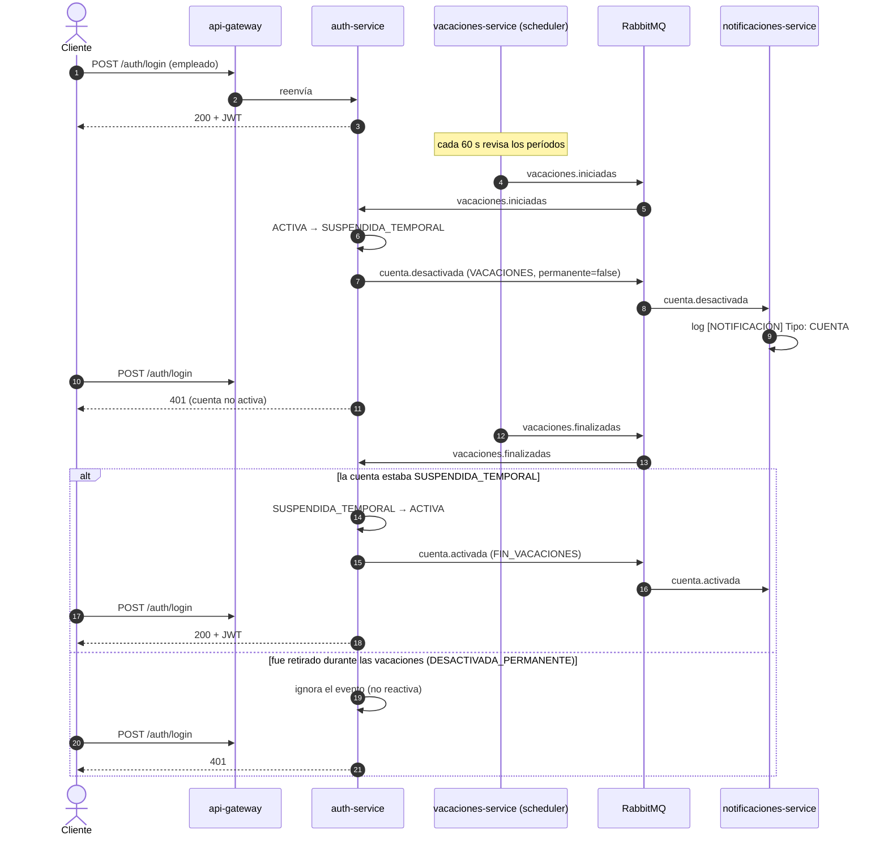
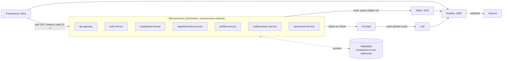
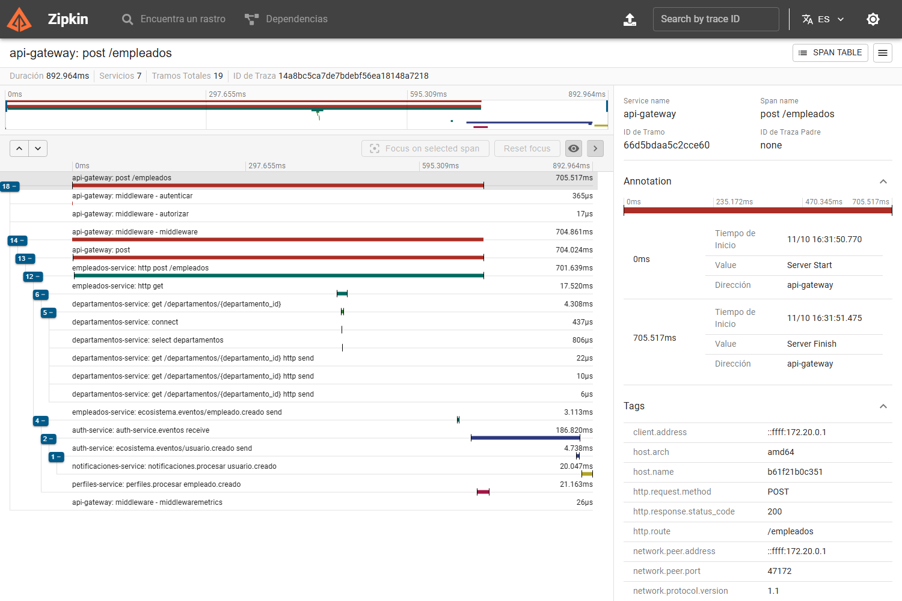
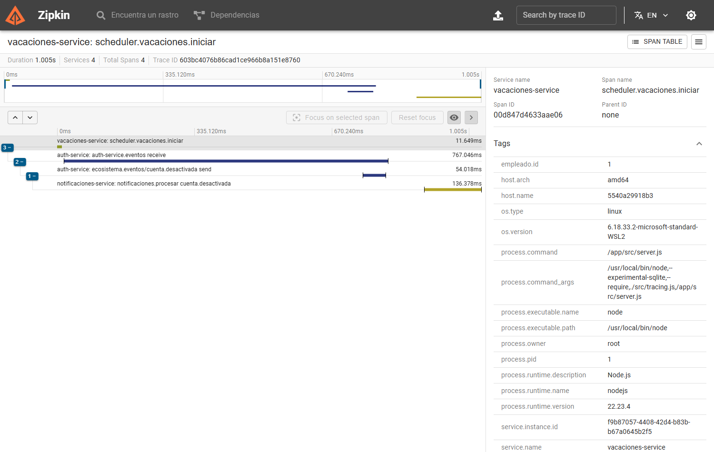
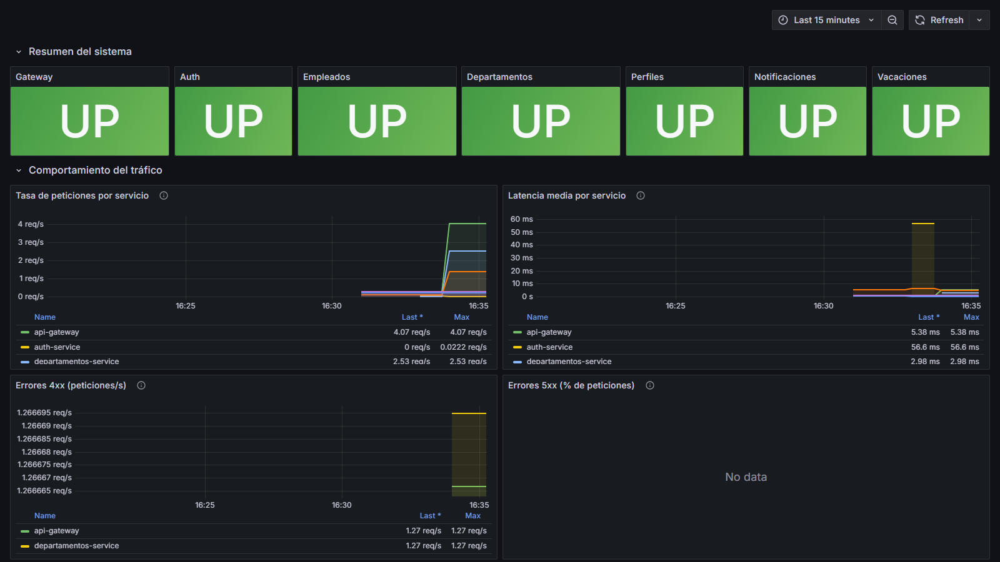
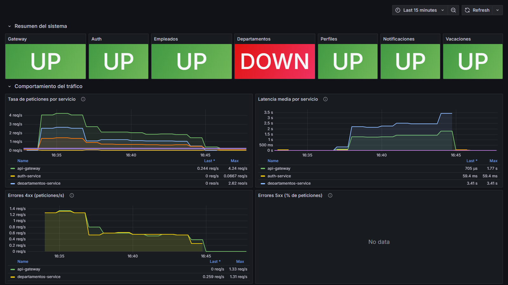
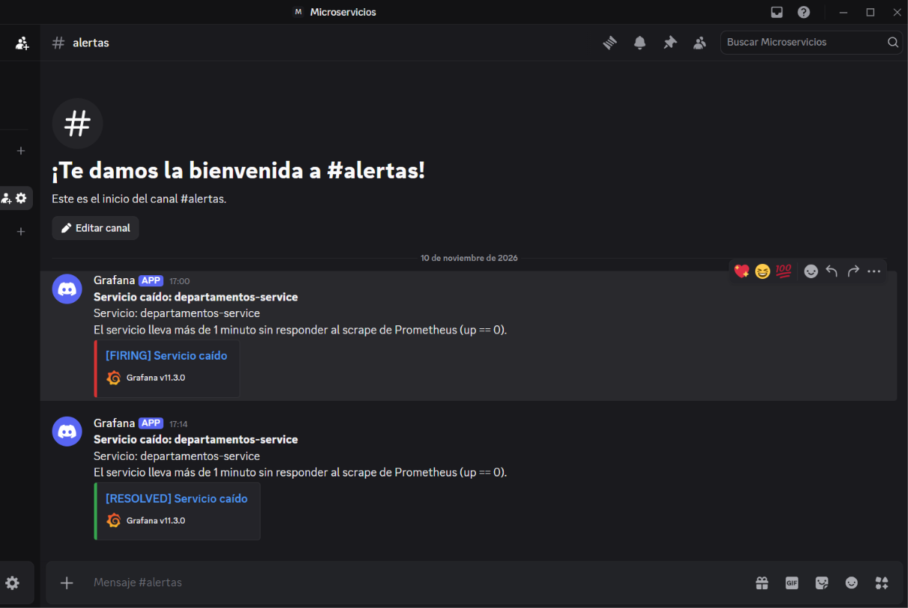
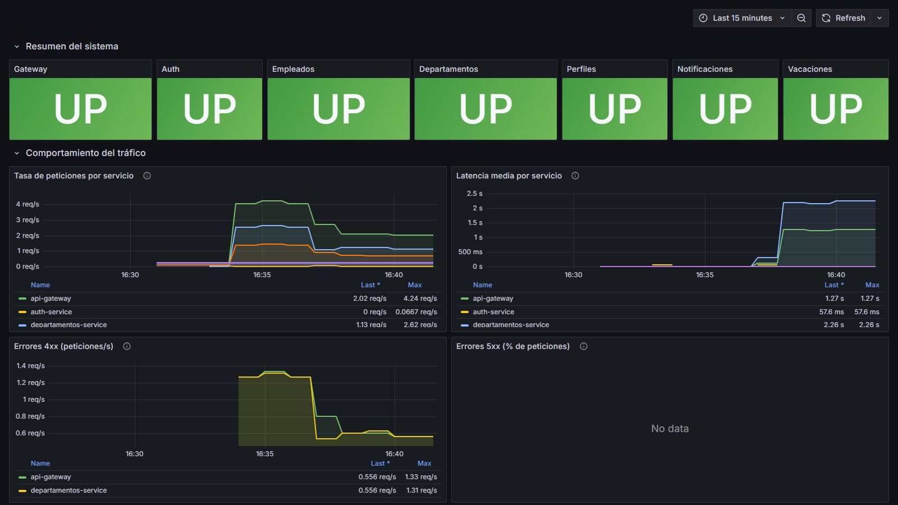
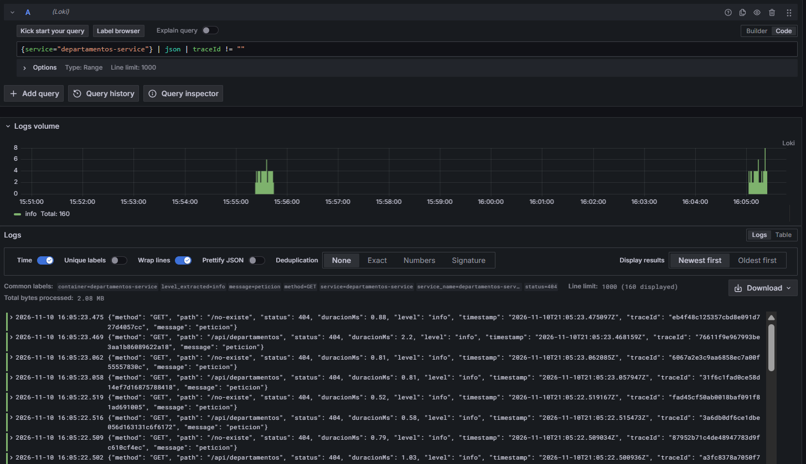

# Sistema de Onboarding/Offboarding de Empleados — Retos 4, 5, 7 y 8

Sistema de microservicios para gestionar empleados, con comunicación REST
síncrona, comunicación asincrónica por eventos a través de un message broker y,
desde el Reto 5, **autenticación con JWT**, control de acceso por rol y ciclo de
vida automático de las cuentas. Un solo evento (por ejemplo, crear un empleado)
dispara acciones automáticas e independientes en otros servicios.

## Arquitectura

```
Cliente HTTP (curl, Postman, navegador)
        │   único punto de entrada: http://localhost:8080
        ▼
   api-gateway  (valida el JWT y aplica RBAC antes de reenviar)
        ├── /auth/*            ──► auth-service             ──► MySQL (db-auth)
        ├── /empleados/*       ──► empleados-service        ──► MySQL
        ├── /departamentos/*   ──► departamentos-service    ──► PostgreSQL
        ├── /perfiles/*        ──► perfiles-service         ──► SQLite
        ├── /notificaciones/*  ──► notificaciones-service   ──► SQLite
        └── /vacaciones/*      ──► vacaciones-service       ──► SQLite

   message-broker (RabbitMQ) — exchange "ecosistema.eventos"
     empleados-service  ── publica ──► empleado.creado / actualizado / retirado
     vacaciones-service ── publica ──► vacaciones.programadas / iniciadas / finalizadas
     auth-service       ── publica ──► usuario.creado / usuario.recuperacion
                                       cuenta.activada / cuenta.desactivada
     perfiles, notificaciones, auth-service ◄── consumen
```

Comunicación síncrona: `empleados-service` → `departamentos-service` (valida el
departamento) y `vacaciones-service` → `empleados-service` (valida el empleado).
Al host se publican el balanceador de carga (`8080`, que reparte entre las réplicas del Gateway), la interfaz del broker (`15672`) y, desde el
Reto 8, las interfaces de observabilidad (Grafana `3000`, Prometheus `9091` y Zipkin `9411`);
el resto usa `expose:` y solo es alcanzable dentro de la red de Docker.

## Servicios y lenguajes

| Servicio | Lenguaje | Base de datos | Puerto interno | Rol |
|---|---|---|---|---|
| `api-gateway` | Node.js (Express) | — | 8080 (publicado) | Punto de entrada único; valida JWT y aplica RBAC |
| `auth-service` | Java (Spring Boot) | MySQL 8 | 8086 | Login, recuperación y cambio de contraseña, ciclo de vida de la cuenta |
| `empleados-service` | Java 21 (Spring Boot) | MySQL 8 | 8080 | CRUD, baja lógica, publica `empleado.*` |
| `departamentos-service` | Python (FastAPI) | PostgreSQL 16 | 8081 | CRUD de departamentos |
| `perfiles-service` | C# (.NET) | SQLite | 8083 | Consume `empleado.*`; REST de perfiles |
| `notificaciones-service` | Go | SQLite | 8084 | Consume eventos; historial de notificaciones |
| `vacaciones-service` | JavaScript (Node.js) | SQLite | 8085 | CRUD de vacaciones; scheduler de inicio y fin de períodos |
| `message-broker` | RabbitMQ 3 | — | 5672 (interno), 15672 (UI) | Mensajería asincrónica |

## Despliegue

### Prerrequisitos

| Herramienta | Versión | Para qué |
|---|---|---|
| Docker Engine / Docker Desktop | 24 o superior (probado con 29.7) | Ejecutar todo el sistema |
| Docker Compose | **2.24 o superior** (probado con 5.5) | Se usa `!override` en el override del E2E |
| Git | 2.30 o superior | Clonar el repositorio |
| Bash (Linux, macOS, Git Bash) o PowerShell 5.1+ | — | Ejecutar `scripts/setup-secrets` |
| RAM libre para Docker | 8 GB mínimo (con `GATEWAY_REPLICAS=1` y `EMPLEADOS_REPLICAS=1`), 12 GB recomendado | Sistema + observabilidad + Jenkins |
| Puertos libres | 8080, 15672, 3000, 9091, 9411, 9090 (y 9000, 5000 con el perfil `ci`) | Balanceador, broker, Grafana, Prometheus, Zipkin, Jenkins |

No hace falta instalar Java, Node, Python, .NET ni Go: todo se compila dentro de Docker.

```bash
git clone https://github.com/JeffersonRodriguezV/Proyecto-Microservicios.git
cd Proyecto-Microservicios
bash scripts/setup-secrets.sh   # genera secrets/ (un archivo por secreto) y .env (solo config)
                                # Windows: powershell -ExecutionPolicy Bypass -File scripts\setup-secrets.ps1
docker compose up --build
```

### Secretos y rotación

Ninguna contraseña ni clave está en el repositorio ni en variables de entorno de los
contenedores: se usan **Docker Compose Secrets**. `scripts/setup-secrets.sh` (o `.ps1`) crea
la carpeta `secrets/` con **un archivo por secreto** (`jwt_secret`, `rabbitmq_password`,
`db_auth_password`, `grafana_admin_password`, `discord_webhook_url`, ...), que Compose monta
en `/run/secrets/<nombre>` dentro de cada contenedor. `.env` solo conserva configuración no
secreta. `secrets/` y `.env` están en `.gitignore`; la plantilla sin valores reales está en
[`secrets.example/`](secrets.example/README.md). Sin esa carpeta `docker compose` se detiene
indicando qué archivo falta.

Cómo los lee cada servicio: las imágenes oficiales (MySQL, PostgreSQL, Grafana) usan su
variable `*_FILE`; los siete microservicios incluyen `entrypoint-secrets.sh`, que exporta
`NOMBRE` desde `NOMBRE_FILE` antes de arrancar, de modo que el código de cada servicio (Java,
Node, Python, .NET, Go) no cambia. RabbitMQ y SonarQube leen el secreto en su `entrypoint`;
Jenkins (JCasC) y Grafana (`$__file{}`) lo leen directamente del archivo.

- El script es idempotente: conserva los secretos existentes y, si hay un `.env` de una versión
  anterior, **migra** sus valores (así no se rompen las bases de datos ya creadas).
- **Rotar**: `bash scripts/setup-secrets.sh --rotate` (`-Rotar` en PowerShell). Las bases de
  datos y RabbitMQ guardan la clave anterior en sus volúmenes, así que después hay que
  recrearlos: `docker compose down -v && docker compose up --build` (borra los datos locales).
- `sonar_token` se genera en SonarQube (Mi cuenta > Seguridad) y se pega en `secrets/sonar_token`;
  el webhook real de Discord va en `secrets/discord_webhook_url`.
- **CI**: la credencial `env-sistema` de Jenkins es `secrets/secrets.env` (los mismos secretos
  en formato `CLAVE=valor`), que el script genera y Jenkins monta de solo lectura. El pipeline
  E2E la copia como `.env` y su override (`docker-compose.e2e.yml`) lee los secretos de esas variables,
  porque dentro de Jenkins no hay carpeta `secrets/` visible para el Docker del host.
- Los archivos de `secrets/` quedan con permisos `644` para que los contenedores que no son
  root puedan leerlos; es una concesión de desarrollo local, la carpeta nunca se sube a Git.

En otra terminal, `docker compose ps` debe mostrar los **11 contenedores**
`healthy` (Jenkins incluido). URL base de todo el sistema: `http://localhost:8080` (balanceador). Interfaz del
broker: `http://localhost:15672` (usuario `admin`, contraseña en `secrets/rabbitmq_password`).

- Detener conservando los datos: `docker compose down`
- Reiniciar desde cero (borra todos los datos): `docker compose down -v`

### Accesos por defecto

| Qué | URL | Usuario | Clave |
|---|---|---|---|
| API (balanceador) | http://localhost:8080 | `admin@empresa.com` / `user@empresa.com` | `secrets/admin_password` / `secrets/seed_user_password` |
| Swagger agregado | http://localhost:8080/swagger | — | pública |
| RabbitMQ (UI) | http://localhost:15672 | `admin` | `secrets/rabbitmq_password` |
| Grafana | http://localhost:3000 | `admin` | `secrets/grafana_admin_password` |
| Prometheus | http://localhost:9091 | — | sin autenticación (solo local) |
| Zipkin | http://localhost:9411 | — | sin autenticación (solo local) |
| Jenkins | http://localhost:9090 | `admin` (`JENKINS_ADMIN_ID`) | `secrets/jenkins_admin_password` |
| SonarQube (perfil `ci`) | http://localhost:9000 | `admin` | `admin` en el primer acceso; cámbiela |

### Ejemplos con curl

```bash
# 1) Iniciar sesión como administrador y guardar el token (Linux/macOS/Git Bash)
ADMIN_PASS=$(cat secrets/admin_password)
TOKEN=$(curl -s -X POST http://localhost:8080/auth/login -H "Content-Type: application/json" \
  -d "{\"email\":\"admin@empresa.com\",\"password\":\"$ADMIN_PASS\"}" | sed -E 's/.*"accessToken":"([^"]+)".*/\1/')

# 2) Crear un departamento y un empleado (esto dispara el flujo de onboarding por eventos)
curl -s -X POST http://localhost:8080/departamentos -H "Authorization: Bearer $TOKEN" -H "Content-Type: application/json" \
  -d '{"id":"TI","nombre":"Tecnologia","descripcion":"Area de TI"}'
curl -s -X POST http://localhost:8080/empleados -H "Authorization: Bearer $TOKEN" -H "Content-Type: application/json" \
  -d '{"nombre":"Ana","apellido":"Perez","email":"ana@empresa.com","numeroEmpleado":"EMP-001","cargo":"Desarrolladora","area":"TI","departamentoId":"TI","fechaIngreso":"2026-01-15"}'

# 3) Consultar el resultado: el perfil y la notificación de bienvenida (reemplace 1 por el id devuelto)
curl -s http://localhost:8080/empleados            -H "Authorization: Bearer $TOKEN"
curl -s http://localhost:8080/perfiles/1           -H "Authorization: Bearer $TOKEN"
curl -s http://localhost:8080/notificaciones/1     -H "Authorization: Bearer $TOKEN"

# 4) Offboarding: retirar al empleado (baja lógica) y revisar sus notificaciones
curl -s -X DELETE "http://localhost:8080/empleados/1?motivo=RENUNCIA" -H "Authorization: Bearer $TOKEN"

# Salud del sistema (pública)
curl -s http://localhost:8080/health
```

Los ejemplos van sin tildes a propósito: Git Bash en Windows envía mal los acentos con `curl -d` y el servidor responde `400`.
En PowerShell use `Get-Content secrets\admin_password -Raw` para la clave y `Invoke-RestMethod` en lugar de `curl`.

### Administrador semilla

Al arrancar, `auth-service` crea el usuario administrador:
`admin@empresa.com` con la contraseña del secreto `secrets/admin_password`
(generada por `scripts/setup-secrets`).

## Seguridad (Reto 5)

### Flujo de autenticación

1. `POST /auth/login` con `{email, password}` devuelve un JWT firmado (HS256).
2. El cliente envía `Authorization: Bearer <token>` en cada petición.
3. El Gateway valida firma y vigencia **antes de reenviar** y aplica las reglas
   de acceso. `auth-service` y el Gateway comparten el secreto vía `JWT_SECRET`.
4. El claim `sub` del token es el `empleadoId`; el claim `role` es `ADMIN` o `USER`.

### Reglas de acceso (Gateway)

| Situación | Respuesta |
|---|---|
| Sin token, token inválido, alterado, vencido o que no es de acceso | `401 Unauthorized` |
| `ADMIN` | Permitido en todo |
| `USER`, métodos de lectura (`GET`, `HEAD`, `OPTIONS`) | Permitido |
| `USER`, `POST /auth/change-password` | Permitido (cambia su propia contraseña) |
| `USER`, `PUT /perfiles/{id}` con `id == sub` | Permitido (propiedad del recurso) |
| Cualquier otro caso de `USER` | `403 Forbidden` |

Rutas **públicas** (sin token): `POST /auth/login`, `POST /auth/recover-password`,
`POST /auth/reset-password`, `GET /health` y la documentación Swagger.
Si el servicio destino está caído, el Gateway responde `503` en JSON.

### Endpoints de `auth-service`

| Endpoint | Descripción |
|---|---|
| `POST /auth/login` | Devuelve el JWT. Una cuenta que no está activa responde `401`, igual que una credencial incorrecta |
| `POST /auth/recover-password` | Genera un token de recuperación y publica `usuario.recuperacion`. Responde igual exista o no el correo |
| `POST /auth/reset-password` | Establece la contraseña con el token (activación inicial o recuperación) |
| `POST /auth/change-password` | Cambia la contraseña del usuario autenticado |

## Ciclo de vida de la cuenta

`auth-service` modela el estado de la cuenta (no un booleano):
`PENDIENTE_ACTIVACION → ACTIVA ⇄ SUSPENDIDA_TEMPORAL`, y `DESACTIVADA_PERMANENTE`
cuando el empleado es retirado.

| Evento consumido | Acción en `auth-service` | Evento publicado |
|---|---|---|
| `empleado.creado` | Crea la cuenta inactiva con rol `USER` y un token de activación | `usuario.creado` |
| `vacaciones.iniciadas` | Suspende la cuenta de forma temporal | `cuenta.desactivada` (`VACACIONES`, `permanente: false`) |
| `vacaciones.finalizadas` | Reactiva la cuenta **solo si** estaba suspendida | `cuenta.activada` (`FIN_VACACIONES`) |
| `empleado.retirado` | Desactiva la cuenta de forma permanente | `cuenta.desactivada` (`RETIRO`, `permanente: true`) |

**Caso borde:** si un empleado es retirado durante sus vacaciones, al llegar
`vacaciones.finalizadas` la cuenta **no se reactiva**; el servicio registra la
advertencia y el login sigue fallando.

### Diagrama de secuencia



### Scheduler de vacaciones

`vacaciones-service` revisa cada `SCHEDULER_INTERVAL_SECONDS` (60 por defecto) y,
en la zona horaria `TZ` (`America/Bogota`): primero pasa a `FINALIZADA` los
períodos `EN_CURSO` cuya `fechaFin` es anterior a hoy y después pasa a `EN_CURSO`
los `PROGRAMADA` cuya `fechaInicio` ya llegó. Un período de un solo día
(`fechaFin == fechaInicio`) es válido: inicia ese día y termina al siguiente.

- **Limitación (instancia única):** el scheduler corre dentro de cada instancia
  del servicio. Con varias instancias, el mismo evento se publicaría varias veces.
  La deduplicación en el consumidor mitiga el daño, pero no evita el trabajo
  duplicado; la coordinación en el productor (ShedLock) queda para un reto
  posterior. Detalle en [`vacaciones-service/README.md`](./vacaciones-service/README.md).
- **Solo desarrollo:** `POST /vacaciones/{id}/forzar-inicio` y `forzar-fin`
  existen solo si `DEV_ENDPOINTS=true` (variable `VACACIONES_DEV_ENDPOINTS`, activa
  por defecto para poder demostrar el flujo sin esperar días). Desactívela en
  cualquier entorno que no sea de pruebas.

## Rutas del Gateway y documentación OpenAPI

Todos los Swagger se ven **a través del Gateway** y soportan el esquema
`BearerAuth`: haga login, copie el token y péguelo en el botón **Authorize**.

| Ruta externa | Servicio | Documentación Swagger |
|---|---|---|
| `/auth/login`, `/auth/recover-password`, `/auth/reset-password`, `/auth/change-password` | `auth-service` | `http://localhost:8080/auth/swagger-ui.html` |
| `/empleados`, `/empleados/{id}` | `empleados-service` | `http://localhost:8080/empleados/swagger-ui.html` |
| `/departamentos`, `/departamentos/{id}` | `departamentos-service` | `http://localhost:8080/departamentos/docs` |
| `/perfiles`, `/perfiles/{empleadoId}` | `perfiles-service` | `http://localhost:8080/perfiles/swagger` |
| `/notificaciones`, `/notificaciones/{empleadoId}` | `notificaciones-service` | `http://localhost:8080/notificaciones/docs` |
| `/vacaciones`, `/vacaciones/{id}` | `vacaciones-service` | `http://localhost:8080/vacaciones/api-docs/` |
| `/health` | El propio Gateway | — |

Cada servicio publica su documentación bajo su propio prefijo, así el Gateway la
reenvía sin reglas adicionales, y declara el servidor `/` para que *Try it out*
use el host del Gateway.

## Eventos

Siguen el **Catálogo de Eventos** del ecosistema (nombres, envelope y cargas
útiles sin cambios). Todos usan el envelope `{id, type, version, occurredAt,
producer, data}` y se publican en el exchange `ecosistema.eventos` (tipo
`topic`), con el nombre del evento como routing key. Cada consumidor tiene su
propia cola durable.

## Escalabilidad y resiliencia

- **Balanceador de carga (Traefik, contenedor `lb`).** Es el único punto de entrada
  (`http://localhost:8080`). Descubre las réplicas por etiquetas de Docker, les hace health check
  a `/health` cada 5 s y retira del reparto a la que falla; si una conexión no se puede abrir,
  reintenta en otra réplica. Un segundo puerto **interno** (`lb:8088`) balancea `empleados-service`
  para el gateway y `vacaciones-service`.
- **Escalado horizontal.** `api-gateway` y `empleados-service` son *stateless* (el estado está en
  MySQL y en el broker) y corren con **2 réplicas** por defecto: `GATEWAY_REPLICAS` y
  `EMPLEADOS_REPLICAS` en `.env` lo cambian (con poca RAM, `=1`), o `docker compose up -d --scale api-gateway=3`.
  Por eso esos dos servicios no tienen `container_name`. No se replican los servicios con SQLite
  (perfiles, notificaciones, vacaciones): un archivo SQLite no se comparte entre instancias.
- **Prometheus** descubre cada réplica por DNS (`dns_sd_configs`) y las métricas se agregan por servicio.
- **Timeouts, reintentos y circuit breaker.** El gateway corta con `503` a un servicio que no responde en
  `PROXY_TIMEOUT_MS` (15 s). `empleados-service` → `departamentos-service` usa 4 reintentos con espera creciente
  y un circuit breaker (Resilience4j) cuyo *fallback* acepta al empleado como «pendiente de validar»
  (`departamentoValidado=false`) y lo reconcilia después.
- **Prueba realizada** (con 2 réplicas de cada una): se detuvieron `api-gateway-1` y `empleados-service-1` en pleno tráfico y de
  120 peticiones respondieron 118; los 2 fallos fueron en el instante de la caída y, tras ~5 s de health check, 0 errores. Con
  `departamentos-service` detenido, crear empleados devuelve `200` por el fallback (cada uno tarda ~10 s por los reintentos).
- **Limitación conocida:** cada réplica de `empleados-service` lleva su propio circuit breaker, así que con varias réplicas
  el circuito tarda más en abrirse (cada una necesita sus propias 3 llamadas fallidas).

## Métricas de negocio

Además de las métricas técnicas (tráfico, latencia, errores HTTP), el sistema expone contadores de negocio, graficados en la fila
«Métricas de negocio» del dashboard de Grafana:

| Métrica | Servicio | Significado |
|---|---|---|
| `empleados_creados_total` | empleados-service | Empleados dados de alta con éxito |
| `empleados_retirados_total` | empleados-service | Empleados dados de baja con éxito |
| `empleados_operaciones_rechazadas_total{operacion}` | empleados-service | Altas/bajas rechazadas por una regla de negocio (duplicados, inexistente...) |
| `notificaciones_enviadas_total{tipo}` | notificaciones-service | Notificaciones generadas, por tipo (CUENTA, SEGURIDAD, VACACIONES, DESVINCULACION) |
| `notificaciones_errores_total{causa}` | notificaciones-service | Errores al procesar o guardar una notificación |

## Integración continua (Reto 7)

Cada servicio tiene un pipeline declarativo en Jenkins que compila, prueba,
mide cobertura, valida la calidad en SonarQube, publica la imagen Docker y
ejecuta la suite E2E (BDD). Jenkins forma parte de `docker-compose.yml` y arranca
con el sistema (`docker compose up --build`); SonarQube y el registry, que consumen
mucha RAM, solo arrancan con el perfil `ci` (`docker compose --profile ci up -d`).
El pipeline E2E corre en un proyecto Compose aparte (`-p e2e`) que no incluye los
servicios de CI, de modo que su `down -v` nunca toca a Jenkins. Detalle de
convenciones en [`docs/convencion-ci.md`](docs/convencion-ci.md).

### Acceso
- Jenkins: http://localhost:9090 (usuario `JENKINS_ADMIN_ID` del `.env`; clave en `secrets/jenkins_admin_password`).
  No hay contraseña inicial aleatoria que buscar: el asistente de configuración está desactivado
  (`runSetupWizard=false`) y el administrador lo crea JCasC con ese usuario y esa clave. Los valores los
  genera `scripts/setup-secrets`.
- SonarQube: http://localhost:9000 (usuario `admin`, clave inicial de SonarQube, cámbiela en el primer acceso).
- Registry local de imágenes: `localhost:5000`.

### Puesta en marcha
a. Ejecutar `scripts/setup-secrets` (crea `.env`, `secrets/` y `e2e-tests/.env`).
b. `docker compose --profile ci up -d` (Jenkins ya sube con el sistema; el perfil `ci` añade SonarQube y el registry).
c. En SonarQube: Quality Gate `cobertura-70` por defecto, token en `secrets/sonar_token` y webhook `http://jenkins:8080/sonarqube-webhook/`.
d. Recrear Jenkins (`up -d --force-recreate jenkins`). Los jobs ya existen (JCasC los importa al arrancar);
   para ejecutar uno a mano: Jenkins → cualquiera de los 8 jobs (`empleados-service`, `auth-service`, `api-gateway`, `departamentos-service`, `perfiles-service`, `notificaciones-service`, `vacaciones-service` o `e2e-bdd`) →
   *Build Now* (en los servicios, *Build with Parameters* permite desmarcar `RUN_SONAR`).

Jenkins se configura solo (JCasC + Job DSL en `jenkins/casc/`): credenciales
`sonar-token`, `env-sistema` y `env-e2e`, servidor Sonar y los 8 jobs (uno por cada uno de los 7 servicios más `e2e-bdd`). Guía
completa y problemas conocidos: [`docs/guia-reproducibilidad-ci.md`](docs/guia-reproducibilidad-ci.md).

### Etapas del pipeline
| Etapa | Qué hace | Si falla |
|---|---|---|
| Checkout | Clona el repo | FAILURE |
| Build & Test | Compila, ejecuta pruebas con cobertura (JaCoCo / c8) y análisis Sonar (`RUN_SONAR`) | Compilación: FAILURE; pruebas rotas: **UNSTABLE** |
| Quality Gate | Espera el veredicto de Sonar por webhook (`cobertura-70`: cobertura < 70 % falla) | FAILURE |
| Package & Publish | `docker build` y `push` al registry (solo si todo es SUCCESS) | FAILURE |
| E2E | Levanta el sistema completo y corre Cucumber en español (solo si todo es SUCCESS) | Escenarios rotos: **UNSTABLE** |

Color del build: azul/verde = SUCCESS, amarillo = UNSTABLE (algo se probó y falló),
rojo = FAILURE (el pipeline se detiene en esa etapa).

### Reportes
| Reporte | Dónde |
|---|---|
| Resultados de pruebas | Build → *Test Result* |
| Cobertura | Build → *Coverage Report*, y dashboard en SonarQube |
| BDD navegable | Build → *Cucumber Reports* y *Reporte BDD* (HTML) |
| Logs del sistema en E2E | Build → artefacto `docker-logs.txt` |

### Capturas
| Qué muestra | Imagen |
|---|---|
| Stage View, build verde |  |
| Resultados de pruebas |  |
| Cobertura (Jenkins) |  |
| Cobertura y Quality Gate (Sonar) |  |
| Reporte BDD navegable |  |

### Fallos simulados
| Fallo | Etapa donde se detiene | Evidencia |
|---|---|---|
| Prueba unitaria rota | Build & Test → UNSTABLE | `docs/img/p1-fallo.png` |
| Cobertura bajo 70 % | Quality Gate → FAILURE | `docs/img/p2-sonar-fallo.png` |
| Escenario BDD roto | E2E → UNSTABLE | `docs/img/e2e-build-fallido.png` |
| Dockerfile roto (`COPY` a una ruta inexistente) | Package & Publish → FAILURE; E2E se omite | `docs/img/p4-fallo-dockerfile.png` |

El fallo de Dockerfile se simula con *Replay* de Jenkins: se modifica solo la
copia del workspace, el repositorio no se toca.

## Observabilidad (Reto 8)

El sistema expone los tres pilares de la observabilidad: **métricas** (Prometheus), **trazas distribuidas** (Zipkin) y **logs centralizados** (Loki + Promtail), todo visible en **Grafana** y con **alertas** al canal de Discord del equipo. Todos los servicios están instrumentados (los 7), y la configuración de Grafana (datasources, dashboard y alertas) está versionada en `observability/`, así que `docker compose up` deja todo listo sin pasos manuales.

### Arquitectura de observabilidad



| Componente | Imagen | Acceso desde el host | Para qué |
|---|---|---|---|
| Grafana | `grafana/grafana:11.3.0` | http://localhost:3000 (`admin` / clave en `secrets/grafana_admin_password`) | Dashboard, exploración de logs y trazas, alertas |
| Prometheus | `prom/prometheus:v2.55.1` | http://localhost:9091 (el 9090 lo usa Jenkins) | Recolecta métricas y evalúa reglas (`observability/prometheus/`) |
| Zipkin | `openzipkin/zipkin:3.4.2` | http://localhost:9411 | Almacena y muestra las trazas |
| Loki | `grafana/loki:3.2.1` | solo red interna (`loki:3100`) | Almacena los logs |
| Promtail | `grafana/promtail:3.2.1` | — | Lee los logs de los contenedores por `docker.sock` y los envía a Loki |

Prometheus, Grafana, Zipkin, Loki, Promtail y los siete microservicios pertenecen a la **misma red Docker** (`microservices-network`), por eso Prometheus alcanza a cada servicio por su nombre. Las URLs entre contenedores usan esos nombres (`zipkin`, `loki`, `prometheus`), no `localhost`.

### Conceptos

**Los tres pilares.** Cada uno responde una pregunta distinta y se complementan:

| Pilar | Pregunta que responde | Rol | Herramienta aquí |
|---|---|---|---|
| **Métricas** | ¿Cómo se está comportando el sistema? | Números agregados en el tiempo (tasa de peticiones, latencia, errores, estado `up`). Son baratas y sirven para dashboards y alertas: dicen *que* algo va mal | Prometheus + Grafana |
| **Logs** | ¿Qué hizo exactamente un servicio? | Eventos con su contexto, en JSON y con `traceId`. Sirven para investigar un caso concreto: dicen *qué* pasó | Loki + Promtail |
| **Trazas** | ¿Por dónde pasó una petición y dónde se demoró? | El recorrido de una petición a través de todos los servicios, con la duración de cada tramo. Dicen *dónde* está el problema | Zipkin |

A ellos se suma el `/health` de cada servicio (¿está vivo?), que Prometheus consulta de forma indirecta con la métrica `up`.

**Pull vs. Push.** Las métricas usan *pull*: Prometheus consulta `GET /metrics` de cada servicio cada 15 s. Las trazas y los logs usan *push*: el servicio envía sus spans a Zipkin y Promtail envía los logs a Loki.

| | Pull (métricas) | Push (trazas y logs) |
|---|---|---|
| Quién inicia | El servidor consulta a cada servicio | El servicio (o un agente) envía los datos |
| Ventajas | Detecta caídas "gratis": si el scrape falla, `up == 0`. El servidor controla la frecuencia y el servicio solo expone un endpoint | Sirve para eventos puntuales y tareas efímeras: un span o una línea de log ocurren una vez y no se pueden "consultar" después |
| Costos | El servidor debe poder alcanzar al servicio; no sirve para procesos que viven segundos | Si el emisor muere, solo hay silencio: no distingue "sin datos" de "caído" |

Por eso la alerta "Servicio caído" se apoya en `up` (pull), que es justo lo que el push no puede dar.

**OpenTelemetry (OTel).** Proyecto de la **CNCF** (Cloud Native Computing Foundation, la fundación neutral que también aloja a Kubernetes y Prometheus) y estándar abierto, independiente del proveedor, para instrumentar aplicaciones (API, SDK, exportadores y propagadores). Se instrumenta una sola vez y solo cambia el *exportador*: aquí todos exportan a Zipkin, pero cambiar a Jaeger sería cambiar un exportador, no reescribir la instrumentación. Existe SDK para los cinco lenguajes del ecosistema (Java, Node.js, Python, Go y .NET).

**W3C Trace Context.** Estándar para propagar el contexto de una traza entre servicios mediante la cabecera `traceparent`:

```
traceparent: 00-4bf92f3577b34da6a3ce929d0e0e4736-00f067aa0ba902b7-01
             │  └── trace-id (32 hex) ──────────┘ └ parent-id ──┘ └ flags
             └ versión
```

El `trace-id` es común a toda la petición; el `parent-id` identifica el span que hace la llamada. Como todos los lenguajes lo respetan, una traza cruza Node, Java, Python, Go y .NET sin perder el hilo. Por HTTP lo propaga el SDK automáticamente; **por RabbitMQ hay que hacerlo a mano**: el publicador inyecta `traceparent` en las cabeceras del mensaje y el consumidor lo extrae para que su span cuelgue del mismo árbol. Sin eso la mitad asíncrona del sistema aparecería como trazas sueltas.

### Librerías por servicio

| Servicio | Métricas (`/metrics`) | Trazas (→ Zipkin) | Logs JSON con `traceId` |
|---|---|---|---|
| `api-gateway` (Node) | `prom-client` | `@opentelemetry/sdk-node`, `instrumentation-http`, `instrumentation-express`, `exporter-zipkin` | `winston` |
| `vacaciones-service` (Node) | `prom-client` | Las mismas, más un **span raíz manual** en el scheduler e inyección de `traceparent` en el mensaje | `winston` |
| `empleados-service` y `auth-service` (Spring Boot) | Micrometer + `micrometer-registry-prometheus` en `/actuator/prometheus` | `spring-boot-starter-opentelemetry`, `spring-boot-zipkin`, `opentelemetry-exporter-zipkin`; observación de RabbitMQ activada (`spring.rabbitmq.*.observation-enabled`) | Logging estructurado de Spring Boot (formato `logstash`) |
| `departamentos-service` (FastAPI) | `prometheus-fastapi-instrumentator` (con `should_group_status_codes=False`) | `opentelemetry-sdk`, `opentelemetry-exporter-zipkin-json`, `instrumentation-fastapi` e `instrumentation-sqlalchemy` | `structlog` |
| `perfiles-service` (.NET) | `prometheus-net.AspNetCore` | `OpenTelemetry.Extensions.Hosting`, `Instrumentation.AspNetCore`, `Exporter.Zipkin`; el consumidor extrae `traceparent` | `Serilog` (`Serilog.AspNetCore` + `Serilog.Expressions`) |
| `notificaciones-service` (Go) | `prometheus/client_golang` | `go.opentelemetry.io/otel`, `otel/sdk`, `otel/exporters/zipkin`; el consumidor extrae `traceparent` | `log/slog` (`JSONHandler`) |

Cada framework nombra distinto la métrica de peticiones HTTP (`http_requests_total`, `http_server_requests_seconds_*` en Spring y `http_requests_received_total` en .NET). `observability/prometheus/rules.yml` las **unifica** en reglas de grabación (`service:http_requests:rate1m`, `service:http_errors5xx:ratio1m`, `service:http_latency_avg_seconds:rate1m`, `service:http_errors4xx:rate1m`), de modo que el dashboard y las alertas funcionan igual para los siete servicios. Los endpoints de `/health` y `/metrics` se excluyen de las métricas y de las trazas para no contaminarlas.

El detalle de cada servicio está en los documentos de `docs/observabilidad-*.md` (ver "Documentación adicional").

### Zipkin frente a Jaeger

Elegimos **Zipkin**:

- **Ligero:** un solo contenedor (`openzipkin/zipkin`) con la memoria acotada (`-Xmx256m`). El sistema ya levanta unos 16 contenedores y el equipo trabaja en portátiles con poca RAM.
- **Soporte directo en los cinco lenguajes:** todos tienen exportador Zipkin para OpenTelemetry, que es justo el que usamos.
- **Integración con Grafana:** hay datasource de Zipkin, así que también se consulta desde Grafana, junto a métricas y logs.
- **Suficiente para el objetivo:** la cascada con la duración de cada span es lo que necesitamos para ver qué servicio se demora.

Lo que perdemos: Jaeger ofrece más funciones (comparar trazas, OTLP nativo, más opciones de almacenamiento) a cambio de más piezas y memoria. Además, aquí Zipkin guarda en memoria, así que **las trazas se pierden al reiniciar el contenedor**; para este proyecto es aceptable, para producción habría que configurar un almacenamiento persistente.

### Dashboard de Grafana

Dashboard **"Reto 8 - Observabilidad del sistema"** (carpeta "Reto 8", UID `reto8-resumen`), provisionado desde `observability/grafana/provisioning/dashboards/sistema.json`:

- **Resumen del sistema:** un panel por servicio con el estado (`up`): verde UP, rojo DOWN.
- **Comportamiento del tráfico:** tasa de peticiones por servicio, latencia media por servicio, errores 4xx (peticiones/s) y errores 5xx (% de peticiones).
- **Métricas de negocio:** empleados creados/retirados, notificaciones enviadas por tipo y errores de negocio (ver [Métricas de negocio](#métricas-de-negocio)).

### Logs con Loki

Promtail lee los contenedores por `docker.sock`, parsea el JSON y etiqueta cada línea con `container`, `service` y `level`. En Grafana → Explore → Loki:

```logql
{service="departamentos-service"} | json | traceId != ""
{service="empleados-service", level="ERROR"}
{service=~"empleados-service|auth-service|perfiles-service|notificaciones-service"} | json | traceId="<id copiado de Zipkin>"
```

La última consulta permite pasar de una traza de Zipkin a los logs de los servicios que registraron algo dentro de ella (con la traza de una creación de empleado aparecen `auth-service`, `perfiles-service` y `notificaciones-service`).

El valor de la etiqueta `level` depende de la librería de cada lenguaje: `INFO` en Java y Go, `info` en Node y Python e `Information` en .NET. Para filtrar por nivel en varios servicios a la vez conviene una expresión regular que ignore mayúsculas, por ejemplo `{service=~".+-service", level=~"(?i)error"}`.

### Canal de alertas: Discord

Las alertas se envían a un canal de Discord mediante un *webhook*, configurado por *provisioning* (`observability/grafana/provisioning/alerting/alerting.yml`): contact point `discord-equipo`, política de notificación y tres reglas.

**Cómo configurarlo:**
1. En Discord: canal → *Editar canal* → *Integraciones* → *Webhooks* → *Nuevo webhook* → *Copiar URL del webhook*.
2. Guardarla en `secrets/discord_webhook_url` (nunca al repositorio; un archivo con la URL y sin salto de línea).
3. Recrear Grafana, que solo lee el secreto al arrancar: `docker compose up -d --no-deps --force-recreate grafana`.
4. Probar en Grafana → *Alerting* → *Contact points* → `discord-equipo` → *Test*.

Si el secreto conserva la URL de relleno, Grafana arranca igual y las alertas no llegan a ningún canal.

| Regla | Condición | Duración | Severidad |
|---|---|---|---|
| Servicio caído | `up < 1` (también si no hay datos) | 1 min | crítica |
| Alta latencia | latencia media > 2 s | 2 min | alta |
| Errores 5xx elevados | más del 5 % de las peticiones | 2 min | alta |

Las reglas se evalúan cada 30 s. El mensaje incluye el servicio afectado (`job`) y llega un `[RESOLVED]` cuando se recupera; las notificaciones se agrupan por `alertname` y `job`.

### Pruebas de caos y evidencias

La simulación de caos se hizo sobre el sistema completo con tráfico real a través del gateway. El procedimiento y el detalle están en [`docs/observabilidad-caos.md`](docs/observabilidad-caos.md).

**Traza completa (cascada en Zipkin).** Un `POST /empleados` autenticado produce una sola traza de 7 servicios y 19 spans: gateway → empleados → departamentos → RabbitMQ → perfiles y auth → RabbitMQ → notificaciones.



La traza del caso difícil, el inicio de vacaciones sin petición que la origine (span raíz manual en el scheduler → auth → notificaciones):



**Dashboard con métricas reales.**



**Caos 1: servicio caído** (`docker compose stop departamentos-service`). Prometheus marca el target en DOWN, el panel de Departamentos se pone en rojo y la regla "Servicio caído" pasa a `Firing`.



**Alerta recibida en el canal** (`[FIRING]` al caer el servicio y `[RESOLVED]` al volver a levantarlo):



**Caos 2: latencia artificial.** Se añadió temporalmente en `departamentos-service` un `sleep` de 5 s en el 50 % de las peticiones, se reconstruyó el contenedor y se envió tráfico. La latencia media de departamentos subió a ~2.4 s y la regla "Alta latencia" pasó a `Firing`. El cambio se revirtió y no está en el repositorio.



**Logs en Loki** (consulta LogQL ejecutada en Grafana):



### ¿Qué servicio tardó más en responder y cómo lo identificaron?

Depende de la situación:

| Situación | Servicio más lento | Cómo se identificó |
|---|---|---|
| Caos de latencia (`sleep` de 5 s en el 50 % de las peticiones) | **`departamentos-service`**: ~2.45 s de latencia media | Panel "Latencia media por servicio" de Grafana (su línea es la más alta) y la alerta "Alta latencia" con `job=departamentos-service` |
| Primera petición `POST /empleados` en frío | **`empleados-service`**: span de ~701 ms (solo 17.5 ms son la llamada a departamentos); después, el consumidor de `auth-service` con ~187 ms | Waterfall de Zipkin: el span más largo del árbol |
| Misma petición con el sistema ya caliente | Todo el flujo dura **24 ms**; lo más lento es el consumidor de `auth-service` (~17 ms), seguido de `empleados-service` (~20 ms en total) | Zipkin |

El método es siempre el mismo: **Grafana dice *qué servicio* está lento** (panel por servicio y alerta, que lo nombra) y **Zipkin dice *dónde* se va el tiempo** dentro de una petición concreta, comparando la duración de cada span de la cascada. La diferencia entre la primera petición (~700 ms) y la repetida (24 ms) apunta a calentamiento (JIT, pool de conexiones) en el servicio Java; no se confirmó con un perfilador.

## Documentación adicional

- [`docs/arquitectura.md`](docs/arquitectura.md): servicios, decisiones y `/health`.
- [`docs/eventos.md`](docs/eventos.md): catálogo de eventos y deduplicación.
- [`docs/observabilidad-vacaciones-notificaciones.md`](docs/observabilidad-vacaciones-notificaciones.md): Reto 8, métricas, logs y trazas de vacaciones y notificaciones (traza del scheduler).
- [`docs/observabilidad-java-dashboard-alertas.md`](docs/observabilidad-java-dashboard-alertas.md): Reto 8, servicios Java (empleados y auth), dashboard de Grafana y alertas.
- [`docs/observabilidad-departamentos-perfiles.md`](docs/observabilidad-departamentos-perfiles.md): Reto 8, departamentos (Python) y perfiles (.NET): métricas, logs y trazas.
- [`docs/observabilidad-caos.md`](docs/observabilidad-caos.md): Reto 8, simulación de caos (servicio caído y latencia artificial), traza desde el gateway y respuesta a "¿qué servicio tardó más?".
- [`docs/guias/`](docs/guias): despliegue local y ejecución de pruebas.
- [`scripts/init-db.sql`](scripts/init-db.sql) y [`scripts/seed-data.sql`](scripts/seed-data.sql): esquema de referencia y datos de ejemplo.
- Swagger agregado de todos los servicios: `http://localhost:8080/swagger`.
