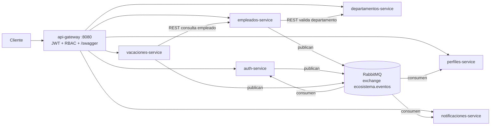

# Arquitectura del sistema

Sistema de gestión de empleados compuesto por 7 servicios independientes, cada uno con su propio
lenguaje, su propia base de datos y su propio Dockerfile. Se comunican por **REST** (síncrono, solo
donde hace falta una respuesta inmediata) y por **eventos en RabbitMQ** (asíncrono, para el resto).



## Servicios

| Servicio | Lenguaje / framework | Puerto | Base de datos | Responsabilidad |
|---|---|---|---|---|
| api-gateway | Node 22 / Express 5 | 8080 (expuesto) | — | Único punto de entrada: valida JWT, aplica RBAC, enruta, agrega `/swagger` |
| auth-service | Java 21 / Spring Boot 4 | 8086 | MySQL | Login, recuperación de clave, ciclo de vida de cuentas |
| empleados-service | Java 21 / Spring Boot 4 | 8080 | MySQL | CRUD de empleados; publica sus eventos |
| departamentos-service | Python 3.14 / FastAPI | 8081 | PostgreSQL | Catálogo de departamentos |
| perfiles-service | .NET 10 / minimal API | 8083 | SQLite | Perfil extendido del empleado |
| notificaciones-service | Go | 8084 | SQLite | Historial de notificaciones |
| vacaciones-service | Node 22 / Express 4 | 8085 | SQLite | Solicitudes y calendario de vacaciones |

Los puertos internos solo existen en la red Docker `microservices-network`; desde el host se entra
únicamente por el Gateway.

## Decisiones de diseño

- **Base de datos por servicio.** Ningún servicio lee tablas de otro; si necesita un dato, lo pide por
  REST o lo recibe por evento. Así cada uno puede cambiar de motor o de esquema sin coordinarse.
- **Políglota a propósito.** Cada servicio usa el lenguaje que mejor encaja y demuestra que el contrato
  (REST + eventos) es lo único compartido.
- **Eventos para la consistencia eventual.** Registrar un empleado no espera a que existan su perfil,
  su cuenta o su correo: se publica `empleado.creado` y cada servicio reacciona. Si un consumidor está
  caído, el mensaje queda en su cola durable.
- **REST solo cuando se necesita respuesta.** `empleados → departamentos` (validar que existe) y
  `vacaciones → empleados` (validar estado). Ambas llamadas tienen timeout y degradan con un error claro.
- **Idempotencia en consumidores.** Un evento puede llegar dos veces; auth, perfiles y notificaciones
  guardan los `id` de evento procesados y descartan repetidos (ver `docs/eventos.md`).
- **Seguridad en el borde.** El Gateway valida firma y vigencia del JWT y aplica RBAC antes de reenviar.
  Los secretos viven en `.env` (fuera del repo) y se generan con `scripts/setup-secrets`.

## Salud y observabilidad básica

Cada servicio expone `GET /health` con el formato:

```json
{ "status": "UP", "service": "perfiles-service", "checks": { "database": "UP", "messageBroker": "UP" } }
```

Responde **200** si todo está UP y **503** si algún check falla. `departamentos-service` no usa broker,
por eso solo reporta `database`; el Gateway no tiene dependencias y devuelve `checks: {}`.
(Los servicios Java conservan además `/actuator/health`.) Las métricas, logs JSON y trazas
distribuidas son el alcance del Reto 8.

## Documentación de API (OpenAPI)

El Gateway agrega las especificaciones de todos los servicios en `http://localhost:8080/swagger`
(solo lectura, sin autenticación). Cada servicio sigue publicando la suya bajo su prefijo.
Se versionan `openapi.yaml` de departamentos, notificaciones, perfiles y vacaciones; en auth y
empleados springdoc la genera en ejecución (`/auth/api-docs`, `/empleados/api-docs`).

## Pruebas y calidad

Todos los servicios tienen pruebas unitarias y de integración y una meta de **cobertura ≥ 70 %**,
verificada en el pipeline de Jenkins con SonarQube (Quality Gate). Ver `docs/convencion-ci.md`.
