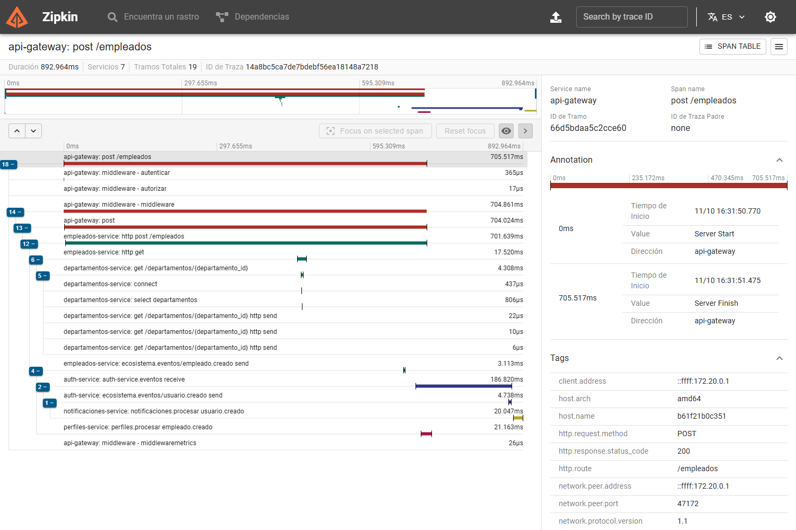
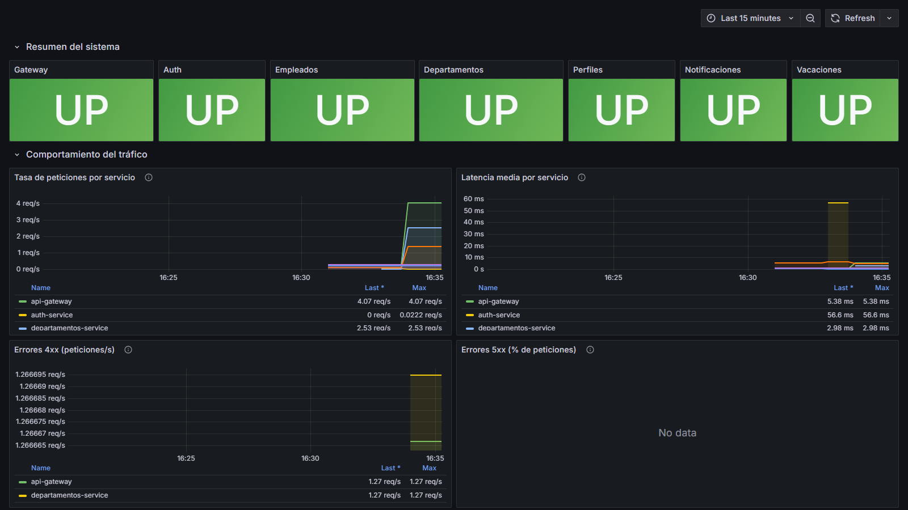
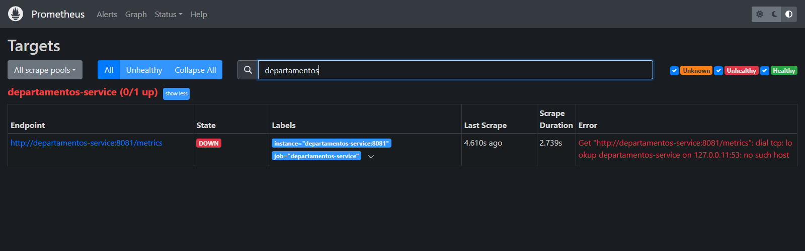
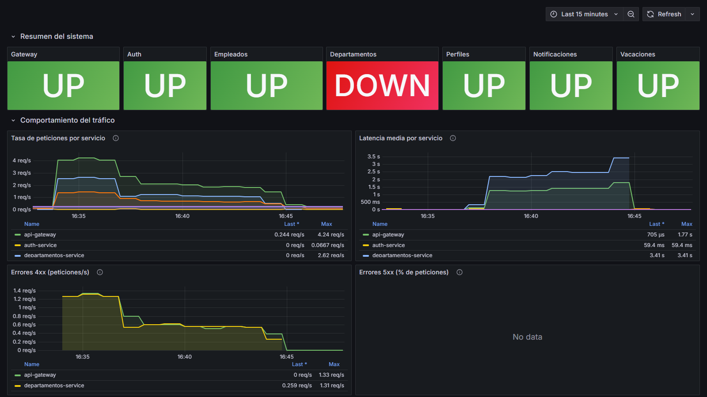
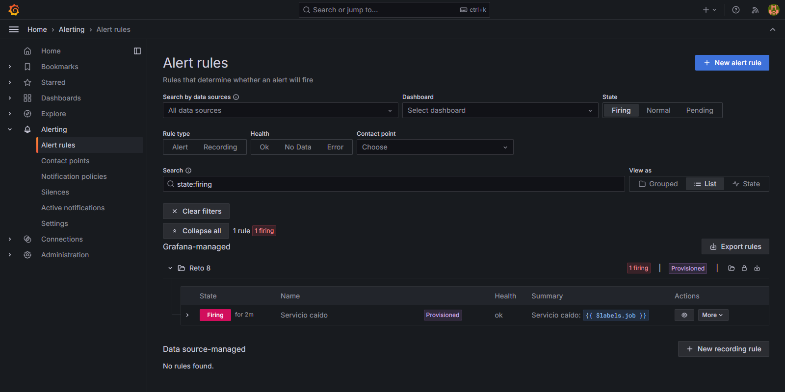
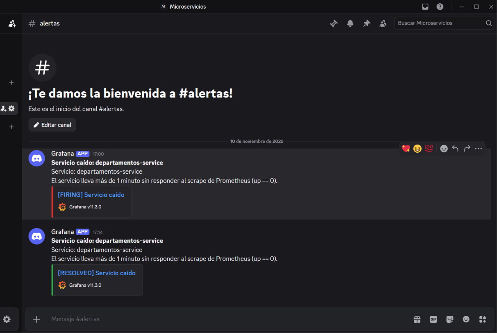
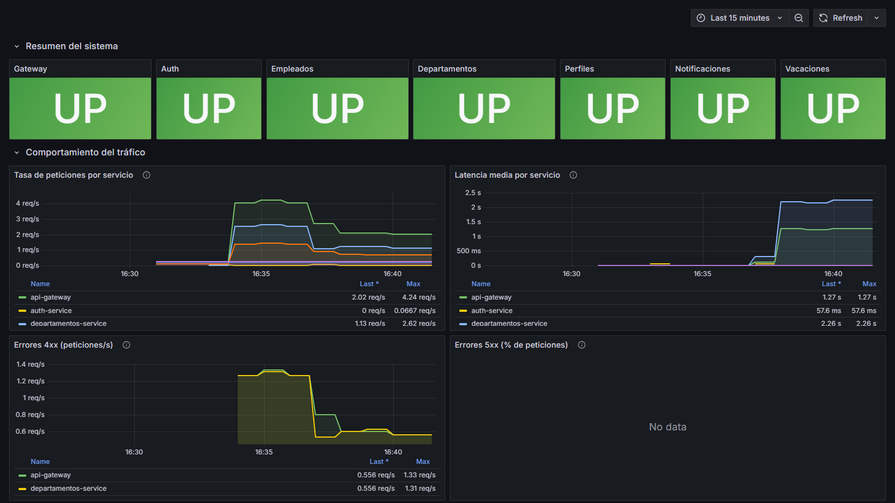
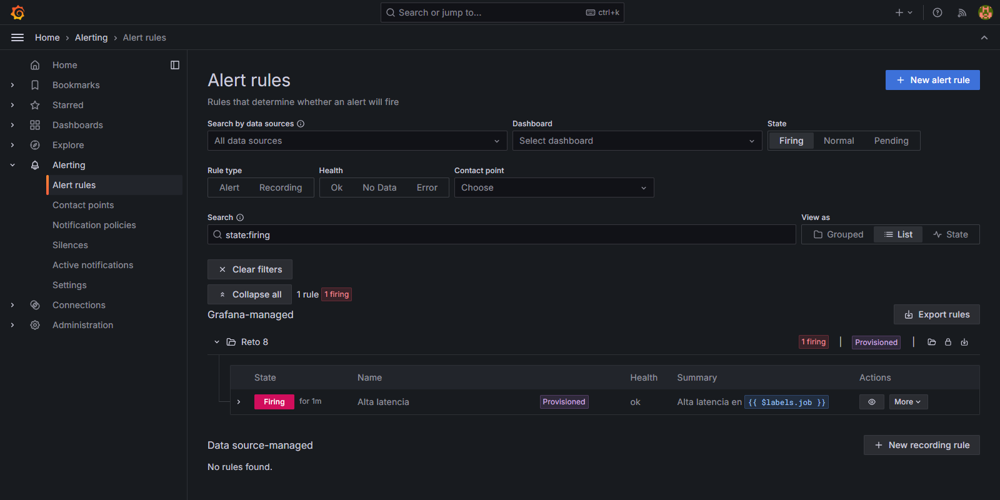

# Reto 8 - Simulación de caos y evidencias (P3)

Evidencias de las pruebas de caos del Reto 8 sobre el stack completo (7 servicios + RabbitMQ + Zipkin + Prometheus + Grafana + Loki/Promtail). Todas las capturas se tomaron con el sistema corriendo en Docker Compose, con tráfico real enviado a través del API Gateway (`http://localhost:8080`).

## 1. Traza completa nacida en el gateway (cascada en Zipkin)

Una petición `POST /empleados` autenticada con JWT recorre el sistema y queda en **una sola traza** de 7 servicios y 19 spans (traza `14a8bc5ca7de7bdebf56ea18148a7218`, 893 ms en total):

`api-gateway` -> `empleados-service` -> `departamentos-service` (con su `SELECT`) -> evento `empleado.creado` por RabbitMQ -> `perfiles-service` y `auth-service` -> evento `usuario.creado` -> `notificaciones-service`.

La parte asíncrona (RabbitMQ) cuelga de la misma traza porque el contexto W3C `traceparent` viaja en las cabeceras del mensaje.



## 2. Dashboard de Grafana con métricas reales

Dashboard "Reto 8 - Observabilidad del sistema" con los 7 servicios en UP y tráfico real (tasa de peticiones, latencia media, errores 4xx y 5xx).



## 3. Caos 1: servicio caído (`docker compose stop departamentos-service`)

Se detuvo `departamentos-service`. En aproximadamente 2-3 minutos:

- En **Prometheus** el target `departamentos-service` pasa a `DOWN`.
- En **Grafana** el panel de Departamentos cambia a rojo (DOWN).
- La regla **"Servicio caído"** pasa a `Firing` y se envía al contact point `discord-equipo`.







Al volver a levantar el servicio (`docker compose start departamentos-service`) la alerta se resuelve y llega el aviso `[RESOLVED]`.

Alerta recibida en el canal de Discord (`#alertas`) con el servicio afectado en el mensaje:



## 4. Caos 2: latencia artificial en el código

Como pide el enunciado, se introdujo **temporalmente** un retardo en `departamentos-service` (middleware de FastAPI colocado antes de la instrumentación, para que las métricas midan el retraso) y se reconstruyó el contenedor:

```python
# === CAOS TEMPORAL (Reto 8) - NO COMMITEAR ===
import asyncio, random

@app.middleware("http")
async def caos_latencia(request, call_next):
    if request.url.path not in ("/health", "/metrics") and random.random() < 0.5:
        await asyncio.sleep(5)  # latencia artificial
    return await call_next(request)
```

Con tráfico sostenido por el gateway, la latencia media de `departamentos-service` subió a ~2.3-2.5 s (la del gateway a ~1.3 s, porque espera a departamentos). Tras mantenerse por encima de 2 s más de 2 minutos, la regla **"Alta latencia"** pasó de `Pending` a `Firing`.





El cambio se **revirtió** (`git checkout -- departamentos-service/app/main.py`) y se reconstruyó el servicio; no está en el repositorio.

## 5. ¿Qué servicio tardó más en responder y cómo lo identificaron?

Depende de la situación, y lo identificamos con las tres herramientas del reto:

| Situación | Servicio más lento | Evidencia |
|---|---|---|
| Caos de latencia (`sleep` de 5 s en el 50 % de las peticiones) | **`departamentos-service`**: ~2.45 s de latencia media | Panel "Latencia media por servicio" de Grafana (la línea de departamentos es la más alta) y la alerta "Alta latencia" con `job=departamentos-service` |
| Primera petición `POST /empleados` en frío | **`empleados-service`**: span `http post /empleados` de ~701 ms (de ellos, solo 17.5 ms son la llamada a departamentos); después, el consumidor de `auth-service` con ~187 ms | Waterfall de Zipkin (traza `14a8bc5c...`): el span más largo del árbol |
| Misma petición con el sistema ya "caliente" | Todo el flujo dura **24 ms**; lo más lento es el consumidor de `auth-service` (~17 ms), seguido de `empleados-service` (~20 ms en total) | Zipkin (traza `baba4c220e179bf0b8852a18478999e2`) |

Cómo se identificó: (1) Grafana muestra *qué servicio* tiene la latencia elevada (panel por `job`) y la alerta lo nombra; (2) Zipkin muestra *dónde* se va el tiempo dentro de una petición concreta, comparando la duración de cada span en la cascada. La diferencia entre la primera petición (~700 ms) y la repetida (24 ms) apunta a calentamiento (JIT, pool de conexiones) en el servicio Java; no se confirmó con un perfilador.

## Cómo reproducirlo

```powershell
# .env debe tener GRAFANA_ADMIN_PASSWORD y DISCORD_WEBHOOK_URL (webhook propio)
docker compose up -d --build

# Caos 1: servicio caído (esperar ~3 min la alerta; luego recuperarlo)
docker compose stop departamentos-service
docker compose start departamentos-service

# Caos 2: añadir el middleware de la sección 4 en departamentos-service/app/main.py
# (antes de configurar_observabilidad), reconstruir, generar tráfico y revertir:
docker compose up -d --build departamentos-service
git checkout -- departamentos-service/app/main.py
```

Nota: si el proyecto de Compose ya existía con otro nombre, hay que usar el mismo (`docker compose -p <nombre> ...`) o aparecerán conflictos de nombres de contenedor; y las imágenes antiguas no traen la instrumentación, así que conviene `--build`.