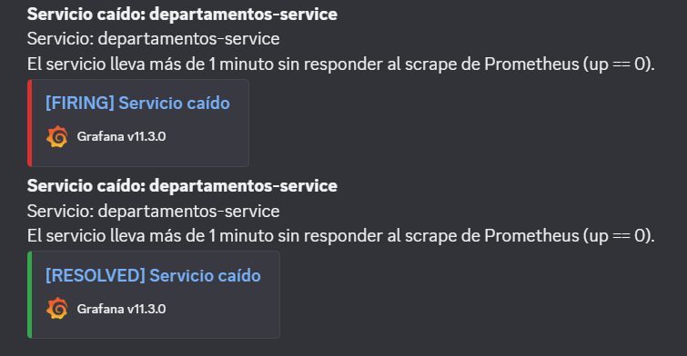
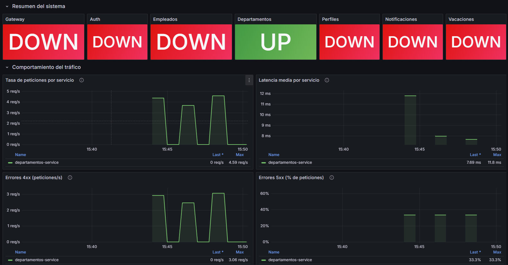
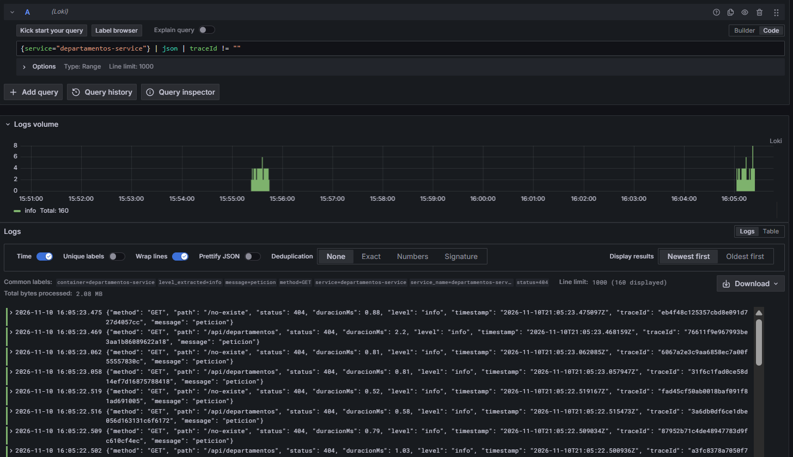

# Reto 8 — Servicios Java, dashboard y alertas

Parte de la Persona 1: `empleados-service` y `auth-service` (Java 21 / Spring Boot 4.1), el dashboard de Grafana y las alertas.

## Librerías (empleados-service y auth-service)

| Pilar | Dependencia | Para qué |
|---|---|---|
| Métricas | `io.micrometer:micrometer-registry-prometheus` + `spring-boot-starter-actuator` | `GET /actuator/prometheus` (CPU, memoria JVM, `http_server_requests_seconds_*` con `method`, `status`, `uri`) |
| Trazas | `spring-boot-starter-opentelemetry` (sin el exportador OTLP), `spring-boot-zipkin`, `io.opentelemetry:opentelemetry-exporter-zipkin` | OpenTelemetry con el starter de Spring Boot y exportador Zipkin |
| Propagación HTTP | `spring-boot-starter-restclient` (solo empleados) | El `RestClient` autoconfigurado propaga `traceparent` hacia departamentos-service |
| Propagación por el broker | Observación de Spring AMQP (propiedades, sin código) | `RabbitTemplate` inyecta `traceparent` al publicar y el `@RabbitListener` lo extrae al consumir |
| Logs JSON | Formato `logstash` nativo de Spring Boot (`logging.structured.format.console=logstash`) | JSON por línea con `traceId` y `spanId` tomados del MDC |

Decisiones:
- **Logs:** se usó el soporte nativo de Spring Boot (mismo esquema JSON "logstash") en vez de `logstash-logback-encoder`, que en Boot 4 (Jackson 3) añade una dependencia más sin aportar nada. Se agrega el campo `service`, se apaga el banner y `show-sql` para que stdout sea solo JSON.
- **Nombres de servicio en Zipkin:** `empleados-service` y `auth-service` (`management.opentelemetry.resource-attributes.service.name`). Cada uno distinto del `spring.application.name`.
- **Endpoint Zipkin:** `management.tracing.export.zipkin.endpoint` (en Boot 4 la propiedad cambió desde `management.zipkin.tracing.endpoint`), sobreescribible con `OTEL_EXPORTER_ZIPKIN_ENDPOINT`.
- **RestClient:** `DepartamentosClientConfig` recibe el `RestClient.Builder` autoconfigurado; con `RestClient.builder()` estático no hay observación y la traza se corta hacia departamentos.
- **Ruido:** `ObservabilidadConfig` excluye `/health` y `/actuator/**` de la observación (healthcheck de Docker y Prometheus).
- **`/health`:** el controlador propio ya devuelve el formato común `{status, service, checks}` y 503 si la base de datos o el broker están DOWN. `/actuator/health` queda como el de Spring (DOWN → 503 por defecto).
- **Métricas unificadas:** las reglas de grabación de Prometheus ya mapean `http_server_requests_seconds_*` a las series `service:*`.

## Verificación

Prueba en Docker (broker + MySQL + Zipkin + los servicios): al crear un empleado, Zipkin muestra **una sola traza** con:

```
empleados-service        http post /empleados                     (SERVER)
empleados-service        http get  -> departamentos-service       (CLIENT)
empleados-service        ecosistema.eventos/empleado.creado send  (PRODUCER)
auth-service             auth-service.eventos receive             (CONSUMER, hijo del PRODUCER)
auth-service             ecosistema.eventos/usuario.creado send   (PRODUCER)
notificaciones-service   notificaciones.procesar usuario.creado   (CONSUMER, hijo del PRODUCER)
```

Los spans propios de departamentos-service y perfiles-service aparecerán cuando P3 los instrumente (ya reciben el `traceparent`). `GET /actuator/prometheus` responde en ambos servicios y los logs salen en JSON con `traceId`. Pruebas unitarias: 43 en empleados y 32 en auth, todas en verde (los tests de integración con Testcontainers no se ejecutaron en esta verificación).

## Dashboard

Archivo: `observability/grafana/provisioning/dashboards/sistema.json` (carpeta "Reto 8", UID `reto8-resumen`). Aparece solo al levantar Grafana.

- **Fila 1, "Resumen del sistema":** 7 paneles de estado (`up` de cada servicio; verde UP, rojo DOWN).
- **Fila 2, "Comportamiento del tráfico":** tasa de peticiones (`service:http_requests:rate1m`), latencia media (`service:http_latency_avg_seconds:rate1m`), errores 4xx (`service:http_errors4xx:rate1m`, regla nueva) y errores 5xx (`service:http_errors5xx:ratio1m`).

## Alertas

Provisioning: `observability/grafana/provisioning/alerting/alerting.yml`.

| Regla | Condición | Duración |
|---|---|---|
| Servicio caído | `up < 1` | 1 min |
| Alta latencia | `service:http_latency_avg_seconds:rate1m > 2` | 2 min |
| Errores 5xx elevados | `service:http_errors5xx:ratio1m > 0.05` | 2 min |

**Canal elegido: Discord** (contact point `discord-equipo`, política raíz hacia él).

Configuración: crear un webhook en el canal de Discord (Ajustes del canal → Integraciones → Webhooks) y poner la URL en `.env`:

```
DISCORD_WEBHOOK_URL=https://discord.com/api/webhooks/...
```

`docker-compose.yml` se la pasa a Grafana y el provisioning la lee. Sin la variable, Grafana arranca con una URL de relleno y la notificación simplemente no llega.

### Probar la alerta
`docker compose stop departamentos-service`, esperar ~2 min: el target pasa a DOWN, el panel se pone en rojo y llega "Servicio caído" al canal.

## Consulta LogQL

```logql
{service="empleados-service"} | json | traceId != ""
```

Para seguir una traza entre servicios: `{service=~"empleados-service|auth-service|notificaciones-service"} | json | traceId="<id copiado de Zipkin>"`.


## Evidencias

### Alerta recibida en Discord
Se detuvo `departamentos-service`; tras ~3 minutos Grafana envió `[FIRING] Servicio caído` y, al volver a levantarlo, `[RESOLVED]`.



### Dashboard con datos reales
Dashboard "Reto 8 - Observabilidad del sistema" con tráfico generado sobre `departamentos-service` (tasa de peticiones, latencia media, errores 4xx y 5xx).



### Consulta LogQL en Grafana
`{service="departamentos-service"} | json | traceId != ""` sobre Loki: logs en JSON con `traceId` correlacionable con Zipkin.


