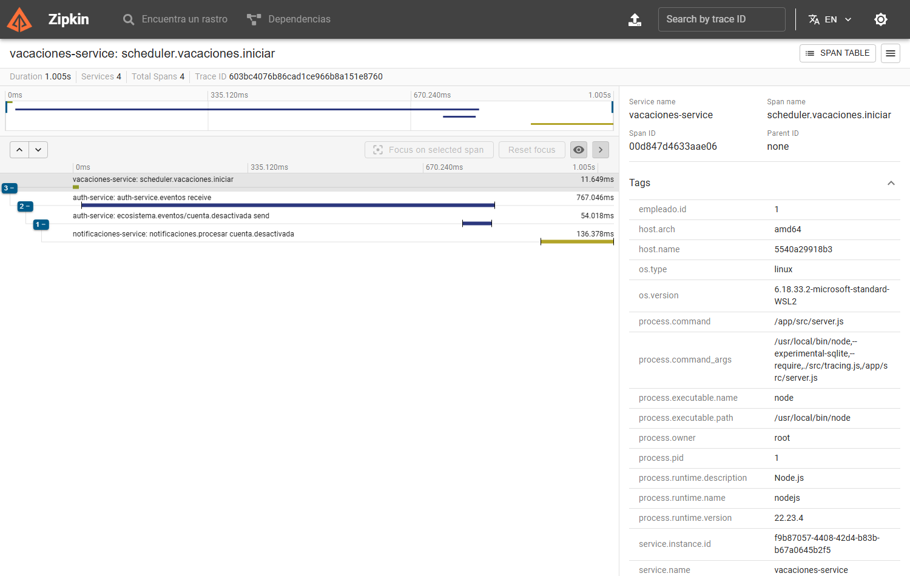

# Reto 8 — Observabilidad de `vacaciones-service` y `notificaciones-service`

Parte de la Persona 2. Los tres pilares (métricas, logs, trazas) quedaron instrumentados en el servicio Node y en el servicio Go, con el mismo contrato que el resto del sistema para que Prometheus, Loki y Zipkin los traten igual.

## Librerías usadas

| Pilar | `vacaciones-service` (Node 22) | `notificaciones-service` (Go) |
|---|---|---|
| Métricas (`GET /metrics`) | `prom-client`: `collectDefaultMetrics` (CPU y memoria del proceso), `http_requests_total{method,status}` y `http_request_duration_seconds` | `prometheus/client_golang`: `ProcessCollector` + `GoCollector`, y las mismas dos métricas HTTP |
| Logs JSON con `traceId` | `winston` (formato `json`, campos `service`, `timestamp`, `traceId`) | `log/slog` con `JSONHandler` y un handler que añade `traceId` desde el contexto |
| Trazas | `@opentelemetry/sdk-node`, `exporter-zipkin`, `instrumentation-http`, `instrumentation-express`, `@opentelemetry/api` | `go.opentelemetry.io/otel`, `otel/sdk`, `otel/exporters/zipkin` |
| Propagación | W3C `traceparent` | W3C `traceparent` |

Los nombres de métrica son los acordados con la infraestructura (reglas de grabación `service:http_requests:rate1m`, `service:http_errors5xx:ratio1m`, `service:http_latency_avg_seconds:rate1m`), por lo que el dashboard funciona igual para los siete servicios.

Decisiones:
- En Node no se usó `auto-instrumentations-node` (más de cien paquetes); basta HTTP + Express, y la parte del broker se instrumenta a mano.
- `/health` y `/metrics` no generan trazas ni logs: el healthcheck de Docker (cada 5 s) y Prometheus inundarían Zipkin.
- `service.name` es `vacaciones-service` y `notificaciones-service`; el exportador apunta a `http://zipkin:9411/api/v2/spans` (variable `OTEL_EXPORTER_ZIPKIN_ENDPOINT`).
- `/health` ya cumplía el formato común (`{status, service, checks:{database, messageBroker}}`, 503 si algo está DOWN) y no necesitó cambios.

## Caso difícil: la traza del scheduler

El scheduler arranca por un temporizador, no por una petición HTTP, así que no hay traza que continuar. Por eso `iniciarPeriodo` (`vacaciones-service/src/scheduler.js`) abre un **span raíz manual** `scheduler.vacaciones.iniciar` y publica dentro de él. `eventoPublisher.js` inyecta el contexto en las cabeceras del mensaje AMQP:

```js
const headers = {};
propagation.inject(context.active(), headers);          // -> headers.traceparent
canal.publish(EXCHANGE, type, Buffer.from(JSON.stringify(envelope)), { headers });
```

Quien consume extrae esa cabecera y sus spans cuelgan de la misma traza. En Go (`notificaciones-service/consumer.go`, `observabilidad.go`):

```go
ctx, span := tracer().Start(contextoDelMensaje(msg), "notificaciones.procesar "+envelope.Type,
    trace.WithSpanKind(trace.SpanKindConsumer))
```

Cadena completa: `scheduler.vacaciones.iniciar` → `vacaciones.iniciadas` → auth-service (extrae `traceparent`, Persona 1) → `cuenta.desactivada` → `notificaciones.procesar`. Notificaciones no consume `vacaciones.iniciadas` directamente; la traza única depende de que auth-service reinyecte el `traceparent` al publicar.

## Evidencia de verificación

Pruebas automáticas: `vacaciones-service/test/trazas.test.js` (span raíz + `traceparent` con el mismo traceId/spanId), `test/observabilidad.test.js`, y `notificaciones-service/observabilidad_test.go` (el span del consumidor cuelga del `traceparent` del mensaje).

Prueba en Docker (broker + Zipkin + servicios):

- Log del scheduler al iniciar el período, con el `traceparent` inyectado:
  ```json
  {"evento":"vacaciones.iniciadas","level":"info","message":"evento publicado","service":"vacaciones-service","traceId":"f9755df1773b5db82e3f954018980083","traceparent":"00-f9755df1773b5db82e3f954018980083-53db6d8a5232cdc4-01"}
  ```
- Zipkin, traza `f9755df1773b5db82e3f954018980083`: `scheduler.vacaciones.iniciar` (`vacaciones-service`, id `53db6d8a5232cdc4`, **sin padre** = raíz; el id coincide con el del `traceparent`).
- Mensaje con `traceparent` publicado en el broker y consumido por Go; Zipkin muestra `notificaciones.procesar cuenta.activada` (`notificaciones-service`) con `parentId` = el span del productor, y el log del consumidor lleva ese mismo `traceId`.
- `GET /metrics` de ambos servicios responde con `process_cpu_seconds_total`, `process_resident_memory_bytes` y `http_requests_total`.

### Captura de la traza del inicio de vacaciones

Traza `603bc4076b86cad1ce966b8a151e8760` en Zipkin: **una sola cascada** desde el scheduler hasta notificaciones, con auth-service (Persona 1) reinyectando el `traceparent`:

```
vacaciones-service       scheduler.vacaciones.iniciar               (span raíz, sin padre)
auth-service             auth-service.eventos receive               (CONSUMER, hijo del scheduler)
auth-service             ecosistema.eventos/cuenta.desactivada send (PRODUCER)
notificaciones-service   notificaciones.procesar cuenta.desactivada (CONSUMER)
```

Reproducción: con la cuenta del empleado ACTIVA, crear un período con `fechaInicio` de hoy y esperar un ciclo del scheduler (60 s). Si la cuenta está en `PENDIENTE_ACTIVACION`, auth ignora el evento y la traza termina ahí.



## Consulta LogQL de apoyo

Logs de ambos servicios de esta parte con su `traceId`:

```logql
{container=~"vacaciones-service|notificaciones-service"} | json | traceId != ""
```
