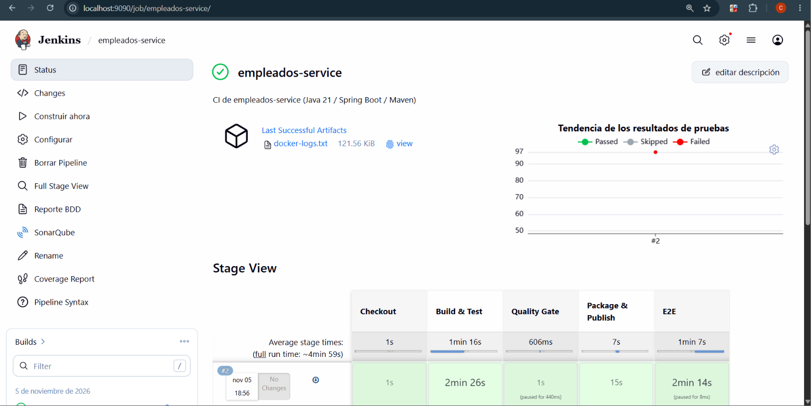
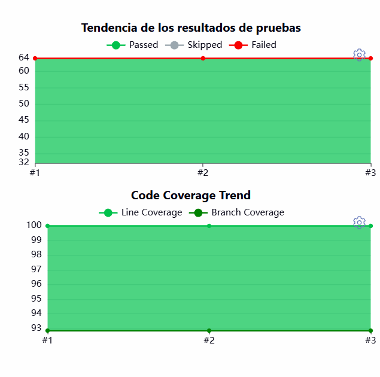
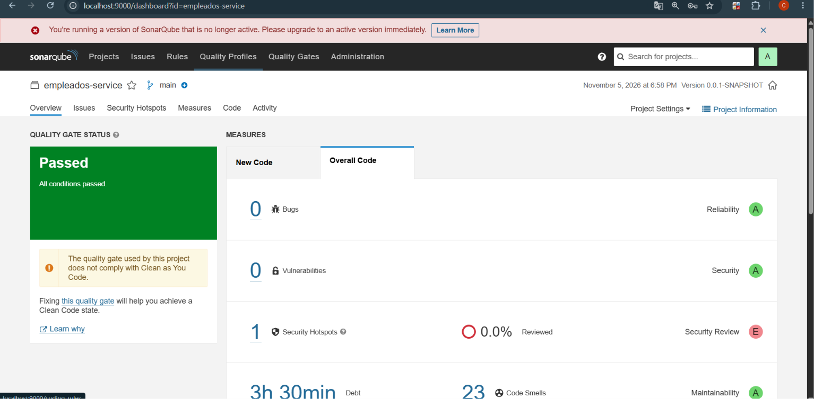
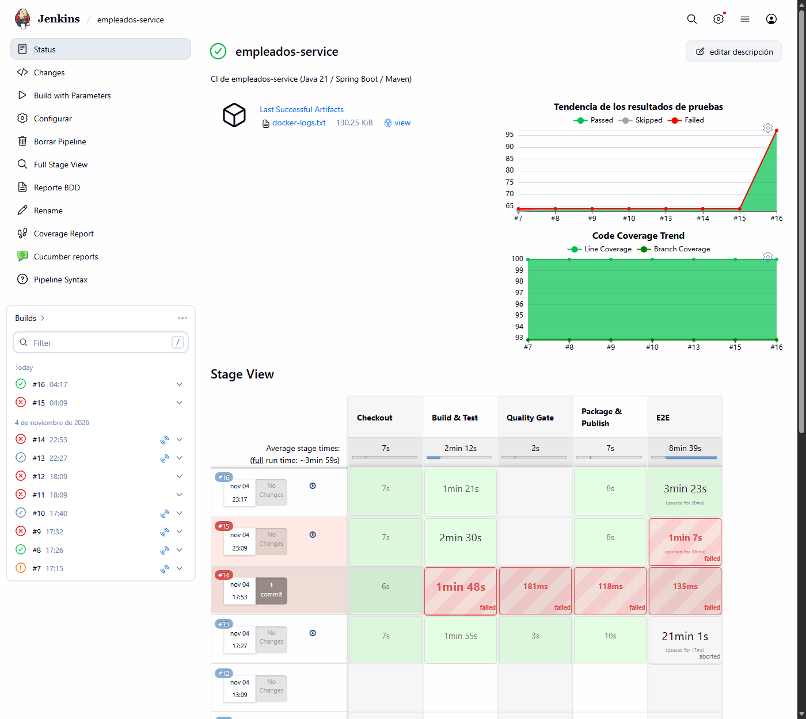
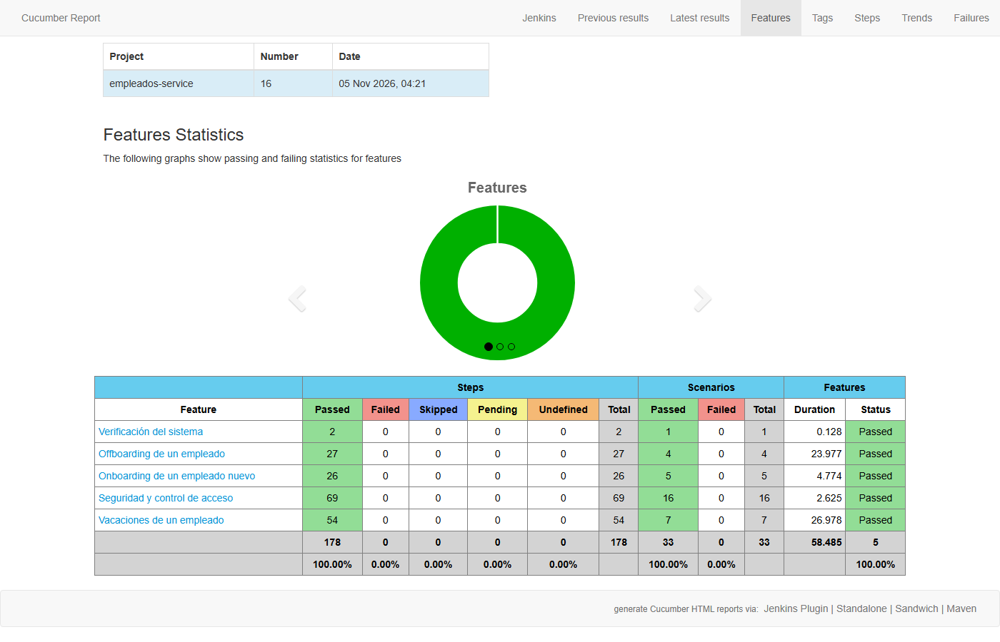
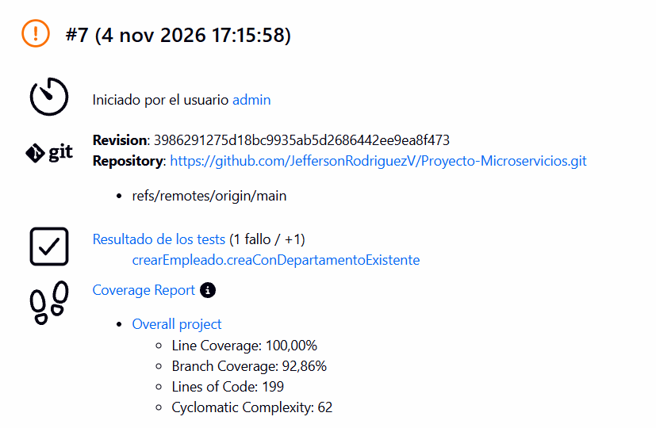
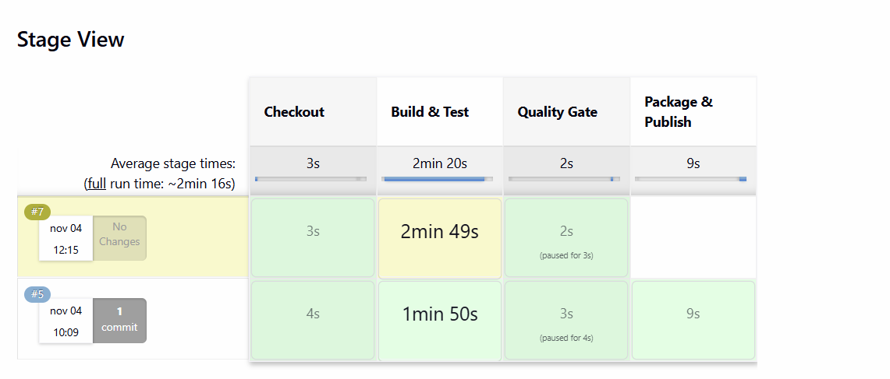

# Reto 7 - Persona 1: pipeline de empleados-service

Pipeline de integracion continua de `empleados-service` (Java 21, Spring Boot, Maven) en Jenkins.

- Pipeline: `empleados-service/Jenkinsfile`
- Job definido como codigo: `jenkins/casc/jobs.yaml` (JCasC + Job DSL)
- Acceso: Jenkins `http://localhost:9090`, SonarQube `http://localhost:9000`, registry `http://localhost:5000`

## Etapas del pipeline

| Etapa | Que verifica | Si falla |
|---|---|---|
| Checkout | Descarga el codigo desde `main` | FAILURE |
| Build & Test | Compila (`mvn clean compile`), ejecuta pruebas unitarias y de integracion (Testcontainers) y mide cobertura con JaCoCo (`mvn verify`) | Compilacion: FAILURE. Tests rotos: UNSTABLE |
| Analisis SonarQube | `sonar-maven-plugin` envia codigo y cobertura al proyecto `empleados-service` | FAILURE |
| Quality Gate | Espera el veredicto de SonarQube (`cobertura-70`) por webhook | FAILURE (aborta el pipeline) |
| Package & Publish | Construye la imagen Docker y la publica en el registry local | FAILURE |
| E2E | Levanta el sistema completo con `docker compose` y ejecuta la suite BDD del Reto 6 (Cucumber.js). Cleanup con `down -v` | Escenarios fallidos: UNSTABLE |

Package & Publish solo se ejecuta si el build llega en SUCCESS: no se publica una imagen de un build con pruebas rotas.

## Tabla de reportes publicados

| Etapa | Reporte | Paso del Jenkinsfile | Donde se consulta |
|---|---|---|---|
| Build & Test | Resultados de pruebas (JUnit XML de surefire/failsafe) | `junit` | Build -> **Test Result** |
| Build & Test | Cobertura JaCoCo, con codigo fuente coloreado | `recordCoverage` (parser JACOCO) | Build -> **Coverage Report** |
| Analisis SonarQube | Calidad, bugs, cobertura y estado del Quality Gate | `withSonarQubeEnv` + `waitForQualityGate` | SonarQube `localhost:9000` -> proyecto `empleados-service` |
| Package & Publish | Imagen `localhost:5000/microservicios/empleados-service:<build>` y `latest` | `docker push` | `curl http://localhost:5000/v2/microservicios/empleados-service/tags/list` |
| E2E | Resultados de escenarios (JUnit XML) | `junit` | Build -> **Test Result** |
| E2E | Reporte BDD navegable, con features y escenarios en espanol | `cucumber` | Menu del job -> **Cucumber reports** (build -> Cucumber reports) |
| E2E | Logs de todos los contenedores del sistema | `archiveArtifacts` (`docker-logs.txt`) | Build -> **Artifacts** |

## Como interpretar los resultados

| Color | Estado | Significado |
|---|---|---|
| Verde | SUCCESS | Compila, todas las pruebas pasan, el Quality Gate pasa y la imagen se publica |
| Amarillo | UNSTABLE | Compila, pero hay pruebas fallidas. El reporte se publica y muestra cual fallo; Package se omite |
| Rojo | FAILURE | Fallo la compilacion, el Quality Gate o el empaquetado: el pipeline se detiene en esa etapa |
| Gris | ABORTED | Cancelado a mano o por timeout (30 min) |

**Diferencia FAILURE / UNSTABLE:** UNSTABLE es "se pudo construir, pero algo no cumple" y deja ver el detalle en los reportes. FAILURE es "no se pudo continuar".

## Decisiones de diseno

- **Agente Maven en Docker** (`maven:3.9-eclipse-temurin-21`) con cache `maven_cache:/root/.m2`: el build no depende de lo instalado en Jenkins y es mas rapido desde la segunda ejecucion.
- **`docker.sock` montado** en el agente: las pruebas de integracion usan Testcontainers.
- **Red del proyecto en el agente** (`--network proyecto-microservicios_microservices-network`): el agente alcanza a SonarQube por su nombre. Si la carpeta del proyecto se llama distinto, hay que ajustar ese nombre en el Jenkinsfile.
- **Tests rotos = UNSTABLE** (`-Dmaven.test.failure.ignore=true`): el fallo queda visible en el reporte y no solo en el log.
- **Quality Gate `cobertura-70`**: Coverage menor a 70% en New Code y en Overall Code. Se asigna directamente al proyecto.
- **`disableConcurrentBuilds()` y timeout de 30 min** para no pisar el workspace y evitar builds colgados.
- **Parametro `RUN_SONAR`** (por defecto `true`): permite ejecutar el pipeline sin SonarQube. Se agrego porque en un equipo de 8 GB de RAM no caben a la vez SonarQube y el E2E (12 contenedores). Con el valor por defecto el analisis y el Quality Gate siempre corren; el build #16 se ejecuto con `RUN_SONAR=false`, y los builds #5 y #8 con Sonar completo.
- **Etapa E2E bajo `lock('e2e-sistema')`** y con scripts SQL cargados en volumenes: el Docker del host no ve el workspace de Jenkins, por eso no se usan bind mounts relativos.
- **Secretos fuera del repo**: el token de SonarQube vive en el `.env` (ignorado por git) y llega a Jenkins como credencial `sonar-token`.

## Resultados

- Pruebas: 64 ejecutadas, 0 fallos.
- Cobertura de lineas: 100 % (199/199). Ramas: 92,86 %.
- Quality Gate: OK.

## Capturas

**Pipeline exitoso (vista de etapas)**

**Pestana Test Result**

**Pestana Coverage**

**Pipeline con E2E (build #16 en verde)**

**Reporte BDD navegable (features y escenarios en espanol)**

## Ejecuciones

| Build | Resultado | Notas |
|---|---|---|
| #2 | SUCCESS | Build y Test: 64 pruebas, 100 % de cobertura de lineas |
| #5 | SUCCESS | Pipeline completo: SonarQube, Quality Gate y Package publicado (`:5` y `latest`) |
| #6 | ABORTED | Timeout en Build & Test: el motor de Docker se quedo sin memoria en el equipo. No es un fallo del pipeline |
| #7 | UNSTABLE | Fallo simulado (ver abajo) |
| #8 | SUCCESS | Tras revertir el fallo simulado: el pipeline vuelve a verde |
| #14 | FAILURE | Primer intento con E2E, sin SonarQube levantado: el analisis no encontro `sonarqube:9000`. Se agrego el parametro `RUN_SONAR` |
| #15 | FAILURE | E2E: el puerto 8080 del equipo estaba ocupado por otra aplicacion; el API Gateway no pudo arrancar |
| #16 | SUCCESS | Pipeline completo con E2E: 33 escenarios (178 pasos) en verde, imagen `:16` publicada. Se ejecuto con `RUN_SONAR=false` |

## Fallo simulado

Se cambio a proposito la asercion de `EmpleadoServiceTest.creaConDepartamentoExistente` (esperaba `ACTIVO` y se puso `RETIRADO`).

- El build termino en **UNSTABLE**, no en FAILURE.
- El Quality Gate paso (la cobertura no cambia), pero **Package & Publish se omitio** (`skipped due to when conditional`).
- La prueba fallida aparece identificada por nombre en **Test Result**.
- Despues se revirtio el cambio con `git revert`.

