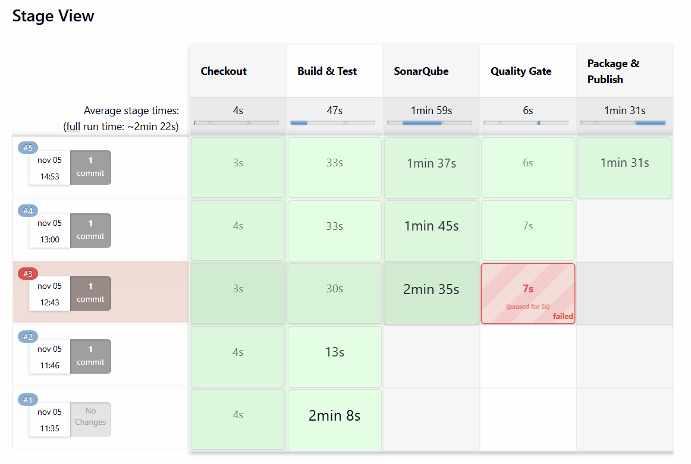
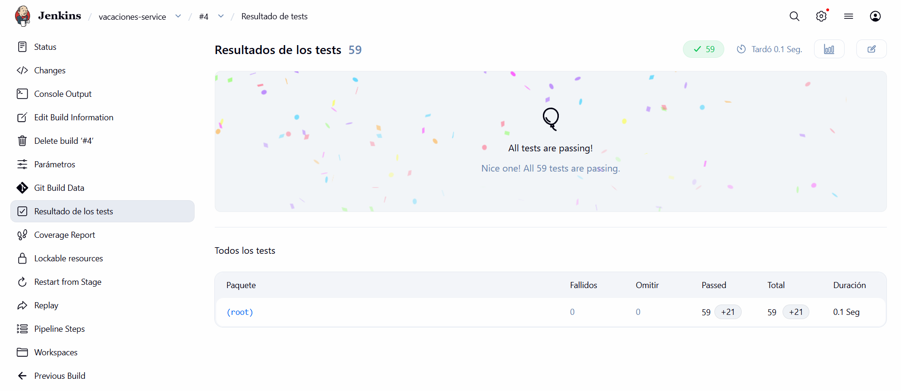
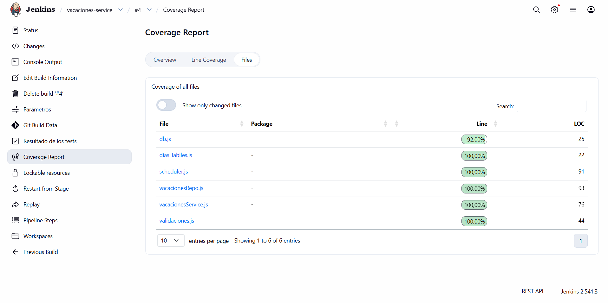
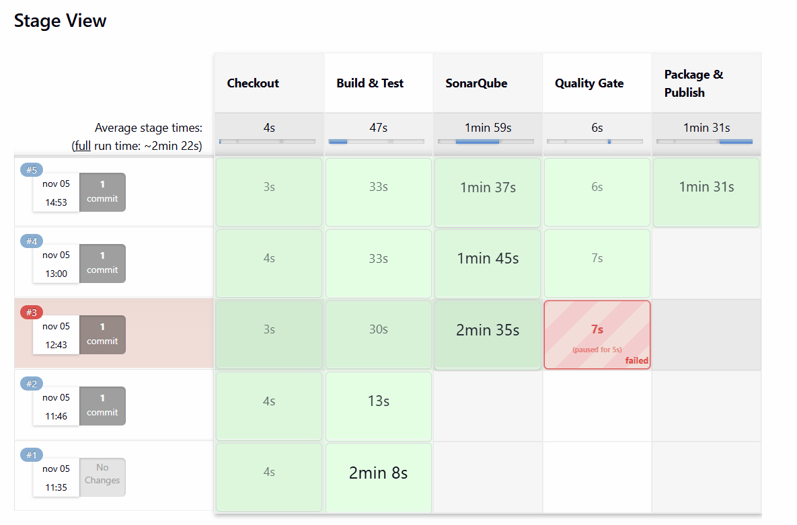
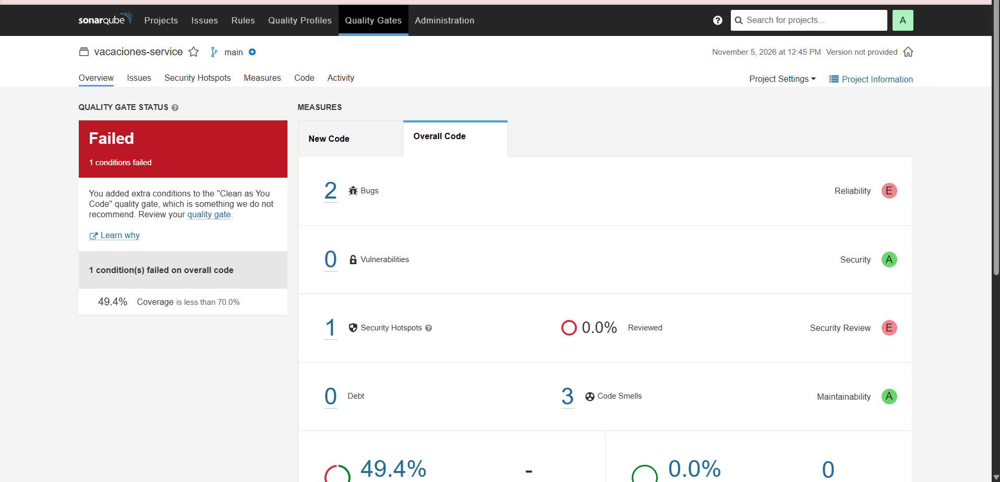
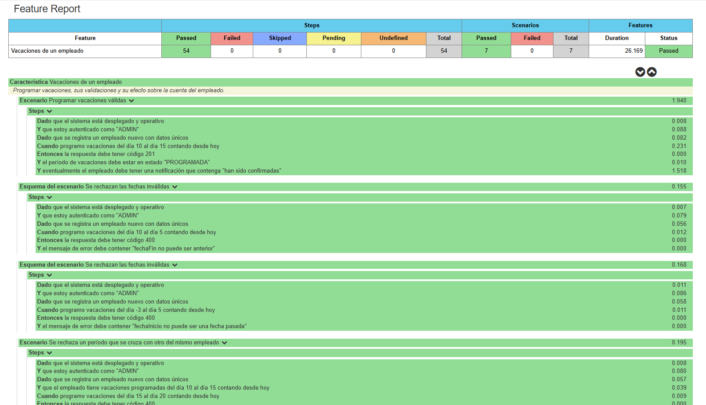

# Reto 7 – CI de `vacaciones-service` (Persona 2)

Pipeline de Integración Continua de `vacaciones-service` (**Node.js 22 + SQLite**), el segundo servicio en un lenguaje
distinto a Java. Convenciones comunes en [`convencion-ci.md`](convencion-ci.md).

- **Jenkinsfile:** [`vacaciones-service/Jenkinsfile`](../vacaciones-service/Jenkinsfile)
- **Job como código:** `jenkins/casc/jobs.yaml` (JCasC + Job DSL)
- **Configuración de Sonar:** [`vacaciones-service/sonar-project.properties`](../vacaciones-service/sonar-project.properties)

## 1. Etapas del pipeline

| # | Etapa | Agente | Qué verifica |
|---|---|---|---|
| 1 | Checkout | nodo Jenkins | Obtiene el código y lo guarda con `stash`. |
| 2 | Build & Test | `node:22` (efímero, caché `npm_cache`) | `npm ci` e instalación reproducible; `npm test` ejecuta 59 pruebas (unitarias, repositorio con SQLite en memoria y scheduler con dobles de prueba) y genera JUnit y lcov. |
| 3 | SonarQube | `sonarsource/sonar-scanner-cli:5.0.1` | Bugs, vulnerabilidades, code smells, duplicación y cobertura importada de `reports/lcov.info`. |
| 4 | Quality Gate | nodo Jenkins | Espera el veredicto de Sonar (por webhook). Si el gate `cobertura-70` falla, el pipeline se aborta. |
| 5 | Package & Publish | nodo Jenkins (socket Docker) | Construye la imagen, la etiqueta `:<build>` y `:latest` y la sube al registro local. Solo si el build va en verde. |
| 6 | E2E Tests | nodo Jenkins + `node:22` | Levanta el sistema completo, ejecuta la suite BDD en español y publica sus reportes. Solo si el build va en verde. |

## 2. Reportes publicados

| Etapa | Reporte | Paso que lo publica | Dónde se ve en Jenkins |
|---|---|---|---|
| Build & Test | Resultados de pruebas (`reports/junit.xml`) | `junit` | Build → **Test Result** y gráfica de tendencia |
| Build & Test | Cobertura (`reports/lcov.info`) | `recordCoverage` (parser `LCOV`) | Build → **Coverage Report** y tendencia |
| SonarQube / Quality Gate | Calidad y cobertura global | `withSonarQubeEnv` + `waitForQualityGate` | Dashboard en `http://localhost:9000` |
| Package & Publish | Imagen en el registro | `docker push` | `http://localhost:5000/v2/microservicios/vacaciones-service/tags/list` |
| E2E Tests | Escenarios BDD (`cucumber.json`, `junit.xml`) | `cucumber`, `junit`, `publishHTML` | Build → **Cucumber Reports** |
| E2E Tests | Logs del sistema (`docker-logs.txt`) | `archiveArtifacts` | Build → Artefactos |

## 3. Cómo interpretar los resultados

| Color | Estado | Significado en este pipeline |
|---|---|---|
| Verde | `SUCCESS` | Compila, todas las pruebas pasan, el gate pasa y la imagen se publicó. |
| Amarillo | `UNSTABLE` | Compiló, pero falla alguna prueba unitaria o algún escenario BDD. Se ve el nombre de la prueba en **Test Result**. No se empaqueta. |
| Rojo | `FAILURE` | El Quality Gate no pasó, o falló el empaquetado o la infraestructura. |

## 4. Decisiones técnicas

- **Lenguaje y agente.** Node.js 22 con SQLite integrado (`node:sqlite`, `--experimental-sqlite`): sin dependencias nativas y sin base externa. El pipeline usa el contenedor efímero `node:22`, así Jenkins no necesita Node instalado.
- **Aprovisionamiento.** JCasC + Job DSL: si Jenkins se recrea, el job reaparece solo. Es más reproducible que `init.groovy.d` y no exige que el código esté montado.
- **FAILURE o UNSTABLE.** Se adopta la convención estándar. Las pruebas se ejecutan con `|| true` para que el pipeline llegue a publicar el reporte; `junit` marca `UNSTABLE`. Un servicio con pruebas fallidas no llega a Package.
- **Cobertura.** Node genera `reports/lcov.info` con `--experimental-test-coverage`. `recordCoverage` usa `sourceDirectories: vacaciones-service` porque las rutas del lcov son relativas a la carpeta del servicio (`src/x.js`).
- **Dependencias.** Volumen `npm_cache` para no descargar los paquetes en cada build.
- **Token de Sonar.** Credencial `sonar-token` de Jenkins, cargada por JCasC desde `SONAR_TOKEN` del `.env`. No aparece en el repositorio ni en el log (queda enmascarado).
- **Quality Gate.** Personalizado, `cobertura-70`: cobertura ≥ 70 % en código nuevo y en código total.
- **Webhook.** SonarQube notifica a `http://jenkins:8080/sonarqube-webhook/` y `waitForQualityGate` recibe el resultado.
- **Scanner.** Imagen `sonarsource/sonar-scanner-cli:5.0.1` como agente efímero, en la red del proyecto; el stack Node no necesita `sonar-scanner` instalado.
- **Naming de imágenes.** `localhost:5000/microservicios/<servicio>:<BUILD_NUMBER>` y `:latest`. El número de build da trazabilidad y es inmutable.
- **Multi-stage.** El Dockerfile es de una sola etapa sobre `node:22-alpine` con `npm ci --omit=dev`: Node no tiene paso de compilación, así que no hay artefacto de build que separar. La imagen queda ligera y sin dependencias de desarrollo.
- **Registro.** Local (`registry:2`, puerto 5000): sin autenticación externa que gestionar.
- **Cobertura y exclusiones.** Ver sección 5.

## 5. Un fallo real que cambió el diseño: cobertura 100 % en Jenkins, 49.4 % en Sonar

En el build #3 el Quality Gate falló: **49.4 % < 70 %**. Jenkins informaba 100 %, porque Node solo reporta los archivos que los tests
cargan (3 de 11). Sonar cuenta todos los de `src` y los 8 restantes entraban con 0 %.

Corrección en dos pasos:

1. **Pruebas nuevas** para la lógica real que no estaba cubierta: `vacacionesRepo.test.js` (SQLite en memoria) y `scheduler.test.js` (dobles de prueba del publicador y del cliente de empleados). Pasaron de 38 a 59 pruebas.
2. **Exclusiones** de cobertura solo para código sin lógica de negocio propia: `server.js`, `swagger.js`, `desarrollo.js`, y los adaptadores `eventoPublisher.js` y `empleadosClient.js`, que se validan en el E2E.

El build #4 pasó el gate con la cobertura corregida.

## 6. Resultados

| Build | Resultado | Notas |
|---|---|---|
| #1 | SUCCESS | Checkout y Build & Test; primera publicación de Test Result y Coverage. |
| #2 | SUCCESS | Segunda ejecución; aparecen las gráficas de tendencia. |
| #3 | **FAILURE** en Quality Gate | Cobertura 49.4 % < 70 %. Fallo real, ver sección 5. |
| #4 | SUCCESS | Con las pruebas nuevas y las exclusiones, el gate pasa. |
| #5 | SUCCESS | Añade Package & Publish: imagen `:5` y `:latest` en el registro. |

Verificación del registro tras el build #5:

```
curl http://localhost:5000/v2/_catalog
{"repositories":["microservicios/vacaciones-service"]}
curl http://localhost:5000/v2/microservicios/vacaciones-service/tags/list
{"name":"microservicios/vacaciones-service","tags":["latest","5"]}
```

## 7. Capturas

**Pipeline exitoso (vista de etapas)**


**Test Result**


**Coverage**


**Build fallido en Jenkins (Quality Gate, build #3)**


**Quality Gate fallido en SonarQube (cobertura 49.4 % < 70 %)**


**Reporte BDD navegable en español** — *pendiente de la corrida E2E*


## 8. Cómo ejecutarlo

1. Levantar Jenkins y SonarQube con `docker compose -f docker-compose.ci.yml up -d`.
2. Entrar en `http://localhost:9090` (usuario y clave de `JENKINS_ADMIN_ID` y `JENKINS_ADMIN_PASSWORD` del `.env`).
3. Abrir el job `vacaciones-service` → **Build with Parameters** → **Build**. Dejar `RUN_SONAR` marcado.
4. Consultar **Test Result**, **Coverage Report** y el dashboard de Sonar.
